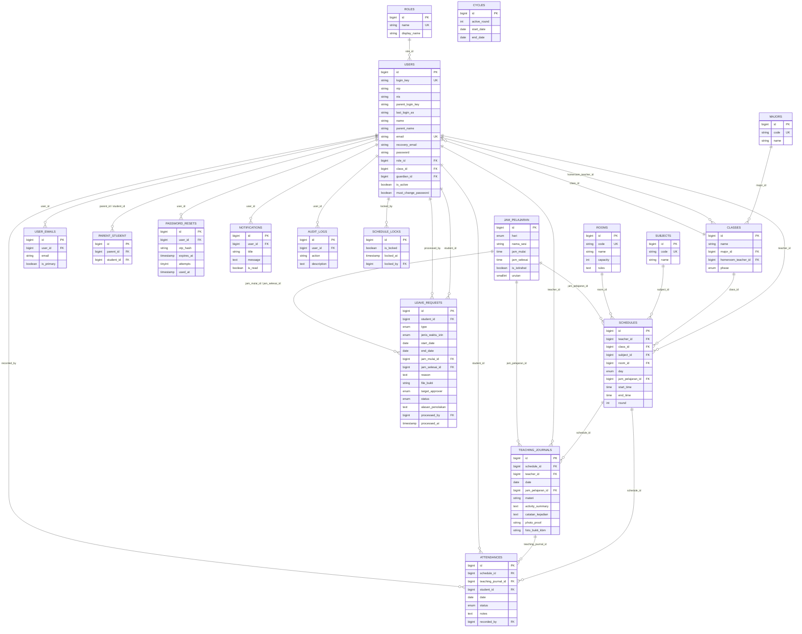
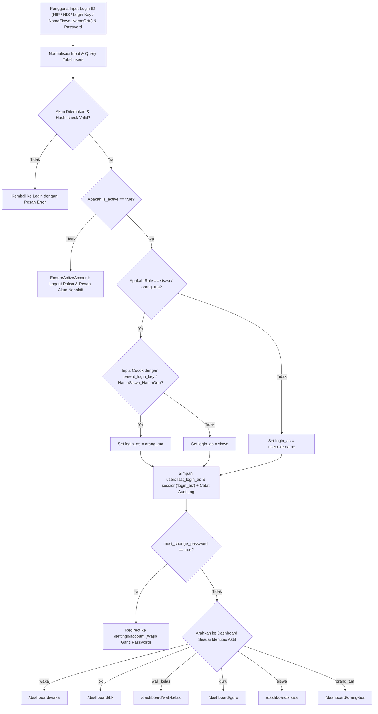
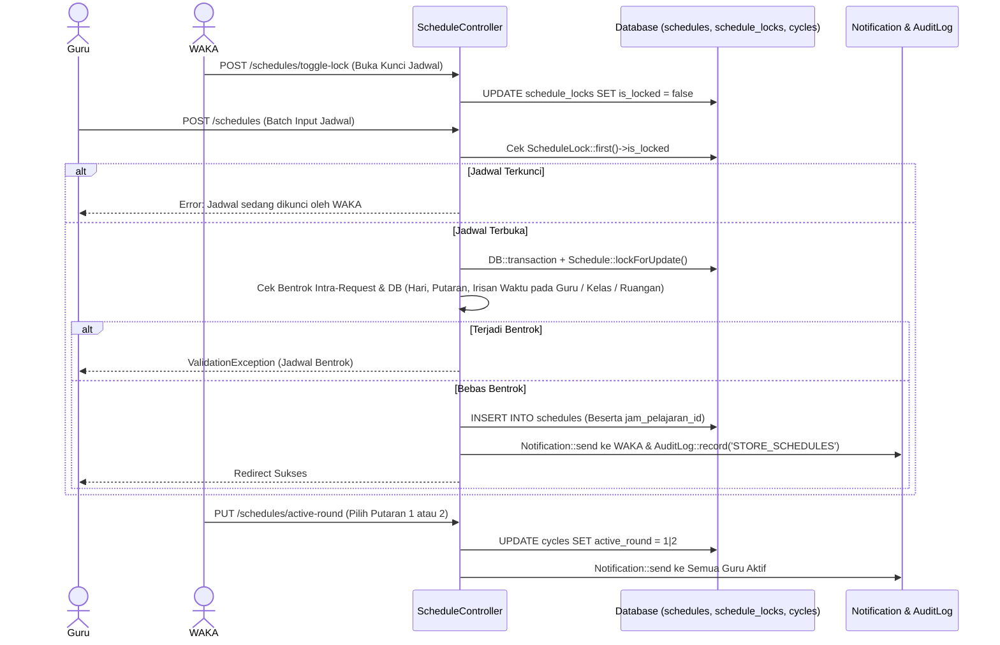
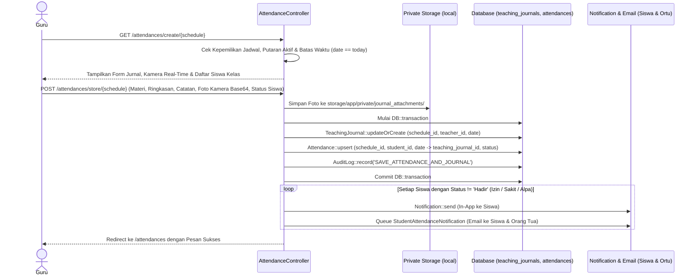
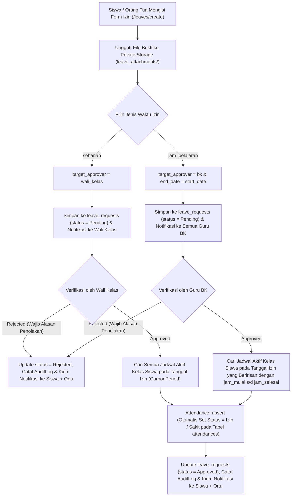

# DOKUMENTASI TEKNIS SISTEM SCHOOL CLASS PROGRESS (SCP)

> **Catatan Metodologi Analisis**: Seluruh isi dokumentasi ini disusun 100% berdasarkan kode sumber aktual yang terdapat di dalam repositori project `scp-systemm` (tanpa asumsi umum di luar implementasi kode).

---

## 1. Pendahuluan

### 1.1 Latar Belakang dan Tujuan Dokumen
Dokumen ini merupakan dokumentasi teknis menyeluruh dari sistem **School Class Progress (SCP)** (dirancang untuk lingkungan akademik SMK Negeri 1 Bantul). Dokumen ini bertujuan menjelaskan secara komprehensif:
1. Arsitektur dan struktur direktori program berbasis **Laravel 13.36.0** dan **PHP 8.4**.
2. Hak akses, pemisahan wewenang, serta mekanisme identitas ganda (*dual-identity login*) pada 6 role pengguna.
3. Cara kerja setiap modul dan fitur baik pada antarmuka **Web (Blade)** maupun **REST API (Mobile/Flutter)**.
4. Skema fisik database (21 tabel aktif dari 30 file migrasi), struktur kolom, tipe data, indeks, *unique constraint*, serta *foreign key*.
5. Pemetaan relasi Eloquent ORM dan *Entity Relationship Diagram* (ERD).
6. Evaluasi integritas database serta analisis keamanan dan validasi sistem.

### 1.2 Ruang Lingkup Sistem
Sistem SCP mengelola siklus operasional Kegiatan Belajar Mengajar (KBM) harian di sekolah yang mencakup:
- Pengelolaan data master akademik (Jurusan, Kelas, Mata Pelajaran, Ruangan, Jam Pelajaran, Penugasan Wali Kelas, dan Penugasan Siswa–Orang Tua).
- Manajemen akun pengguna dan impor massal (*bulk import*) data siswa beserta akun orang tua melalui file `.xlsx` / `.csv`.
- Penyusunan jadwal mengajar guru dengan sistem **Putaran Jadwal (*Round* 1 & *Round* 2)**, deteksi bentrok otomatis (*collision detection*), dan penguncian jadwal (*schedule lock*) oleh WAKA.
- Pencatatan terpadu **Presensi Kehadiran Siswa** (`Hadir`, `Izin`, `Sakit`, `Alpa`) dan **Jurnal Mengajar Guru** disertai bukti foto kamera *real-time* (disimpan di *private storage*).
- Pengajuan permohonan izin/sakit berjenjang: izin **Seharian** diverifikasi oleh **Wali Kelas**, sedangkan izin **Jam Pelajaran** diverifikasi oleh **Guru BK**, dengan sinkronisasi otomatis ke tabel presensi saat disetujui.
- Pengiriman pengingat jurnal mengajar otomatis (30 menit sebelum jam pelajaran berakhir) dan pengingat manual oleh WAKA, serta notifikasi kehadiran via Email dan *In-App Inbox*.
- Rekapitulasi laporan presensi dengan fitur ekspor CSV berproteksi *CSV Injection* serta pencatatan jejak audit (*Audit Log*).

---

## 2. Gambaran Umum Sistem

### 2.1 Arsitektur Aplikasi (Dual-Interface: Web & REST API)
Sistem SCP menerapkan arsitektur *monolith* berbasis pola **Model-View-Controller (MVC)** yang melayani dua kanal klien sekaligus dari satu basis data terpusat:
1. **Kanal Web (`routes/web.php`)**: Menggunakan *server-side rendering* berbasis **Laravel Blade**, **Bootstrap 5.3.3**, dan **Vite**, dengan autentikasi berbasis *database session* serta proteksi CSRF.
2. **Kanal REST API (`routes/api.php`)**: Melayani aplikasi *mobile* (Flutter) menggunakan format respons JSON terstandarisasi (`ApiResponses` trait & Eloquent `JsonResource`), dengan autentikasi **Bearer Token** melalui implementasi kustom `Laravel\Sanctum` (`app/Sanctum/`).

### 2.2 Siklus Permintaan (*Request Lifecycle*)
Ketika pengguna mengirimkan *request* ke aplikasi SCP, alur pemrosesan berjalan sebagai berikut:

1. **Titik Masuk (*Entry Point*)**:
   - Semua *request* HTTP diarahkan ke `public/index.php`, yang memuat autoloader Composer (`vendor/autoload.php`) dan menginisialisasi instance aplikasi dari `bootstrap/app.php`.
2. **Konfigurasi Kernel & Exception (`bootstrap/app.php`)**:
   - Memuat definisi rute dari `routes/web.php`, `routes/api.php` (prefix `/api`), dan `routes/console.php`.
   - Mendaftarkan alias middleware kustom:
     - `'role'` $\rightarrow$ `App\Http\Middleware\CheckRole`
     - `'active'` $\rightarrow$ `App\Http\Middleware\EnsureActiveAccount`
     - `'password.changed'` $\rightarrow$ `App\Http\Middleware\EnsurePasswordChanged`
   - Menangani pengecualian (*exception rendering*) khusus untuk rute `/api/*` atau *request* yang meminta JSON (`ValidationException` $\rightarrow$ 422, `AuthenticationException` $\rightarrow$ 401, `NotFoundHttpException` $\rightarrow$ 404, `HttpException` $\rightarrow$ kode status HTTP terkait).
3. **Bootstrapping Layanan (`app/Providers/AppServiceProvider.php`)**:
   - Memuat kelas-kelas Sanctum kustom (`NewAccessToken`, `PersonalAccessToken`, `HasApiTokens`).
   - Mengatur tampilan pagination default ke Bootstrap 5 (`Paginator::useBootstrapFive()`).
   - Mengarahkan direktori sementara PHP (`TMP`, `TEMP`, `sys_temp_dir`) ke `storage/framework/temp` agar proses unggah file dan ekstraksi ZIP/XLSX tetap berjalan meskipun folder temp bawaan OS tidak dapat ditulis.
   - Mendaftarkan 5 *Rate Limiter* (`login`, `password-reset-send`, `password-reset-verify`, `recovery-email-send`, `recovery-email-verify`).
   - Mendaftarkan *guard* autentikasi `'sanctum'` via `Auth::viaRequest('sanctum', ...)`.
4. **Penyaringan Middleware**:
   - Request melewati *middleware stack* (`web` atau `api`), dilanjutkan dengan pemeriksaan autentikasi (`auth` atau `auth:sanctum`), pemeriksaan status keaktifan akun (`active`), pemeriksaan kewajiban ganti password awal (`password.changed`), dan pemeriksaan otorisasi role (`role:...`).
5. **Eksekusi Controller, Model, dan View / Resource**:
   - **Controller** menerima `Illuminate\Http\Request`, memvalidasi input secara *inline* (`$request->validate(...)`), menjalankan logika bisnis serta transaksi database (`DB::transaction`), memanggil model Eloquent untuk operasi CRUD, mencatat log aktivitas melalui `AuditLog::record()`, dan mengirim notifikasi melalui `Notification::send()` atau `Mail::to()->send()`.
   - Untuk **Web**, Controller mengembalikan `Illuminate\View\View` (merender template Blade di `resources/views/`) atau `RedirectResponse` / `StreamedResponse`.
   - Untuk **API**, Controller membungkus data model ke dalam kelas `App\Http\Resources\*Resource` dan mengembalikan `JsonResponse` melalui trait `App\Http\Controllers\Api\ApiResponses`.

---

## 3. Teknologi yang Digunakan

Seluruh versi teknologi berikut telah diverifikasi langsung dari `composer.json`, `composer.lock`, `package.json`, `vite.config.js`, dan kode sumber aplikasi:

| Kategori | Teknologi / Library | Versi Terverifikasi | Fungsi dalam Sistem SCP |
|---|---|---|---|
| **Bahasa Pemrograman** | PHP | **8.4.14** (Constraint `^8.3`) | Bahasa pemrograman utama di sisi server (*backend*). |
| **Framework Backend** | Laravel Framework (`laravel/framework`) | **v13.36.0** (Constraint `^13.17`) | Kerangka kerja utama aplikasi untuk routing, ORM Eloquent, autentikasi, *middleware*, *queue*, *mail*, dan *blade templating*. |
| **Autentikasi API** | Custom Sanctum (`app/Sanctum/`) | Implementasi Internal | Penyedia autentikasi Bearer Token (`PersonalAccessToken`, `HasApiTokens`, `NewAccessToken`) pada tabel `personal_access_tokens` tanpa ketergantungan paket eksternal `laravel/sanctum`. |
| **Database** | SQLite / MySQL / MariaDB | SQLite (Default `config/database.php`) / MySQL (`school2`) | Penyimpanan relasional untuk seluruh tabel master, transaksi presensi, jurnal, izin, sesi, cache, dan log audit. |
| **Build Tool Frontend** | Vite (`vite` & `laravel-vite-plugin`) | **8.3.4** & **3.2.0** | Bundler aset CSS (`resources/css/app.css`) dan JavaScript (`resources/js/app.js`) ke dalam `public/build/`. |
| **CSS Framework** | Bootstrap 5 & Bootstrap Icons | **5.3.3** & **1.11.3** (via CDN) | Kerangka kerja antarmuka pengguna utama (grid, tabel, modal, form, badge, tombol, dan ikon) di seluruh halaman Blade. |
| **Utility CSS Build** | Tailwind CSS (`tailwindcss`, `@tailwindcss/vite`) | **4.3.3** | Terpasang pada pipeline build Vite (`vite.config.js`). |
| **Tipografi** | Google Fonts (`Plus Jakarta Sans`) & Bunny Fonts (`Instrument Sans`) | Weights 400–800 | Tipografi standar tema antarmuka SCP. |
| **Pemrosesan Spreadsheet** | Native PHP `ZipArchive` & `SimpleXMLElement` | Built-in PHP Ext | Membaca dan membuat file Excel `.xlsx` serta `.csv` untuk fitur impor siswa tanpa menggunakan `phpoffice/phpspreadsheet`. |
| **Tanggal & Waktu** | Carbon (`nesbot/carbon`) | **3.14.2** | Manipulasi tanggal, rentang periode izin (`CarbonPeriod`), dan kalkulasi batas waktu 30 menit pengingat KBM. |
| **Email & Notifikasi** | Laravel Mail (`Symfony Mailer`) | **v13.36.0** | Mengirim email kode OTP reset password (`OtpResetPassword`) dan notifikasi ketidakhadiran siswa ke orang tua (`StudentAttendanceNotification`). |
| **Testing & Quality** | PHPUnit, Laravel Pint, Laravel Boost | PHPUnit **12.5.39**, Pint **1.32.1**, Boost **2.10.4** | Pengujian otomatis (*Feature & Unit Tests* pada `tests/`) dan pemformatan standar kode PHP. |

> **Catatan Fakta Kode**: Sistem ini **tidak menggunakan** layanan WhatsApp gateway pihak ketiga seperti *Fonnte*. Seluruh pengiriman pesan keluar dilakukan melalui **Email (SMTP/Log)** dan **Notifikasi In-App** pada tabel `notifications`.

---

## 4. Struktur Folder dan Program

### 4.1 Peta Direktori Project
Berikut adalah struktur folder aktual dari project `scp-systemm` beserta keberadaan setiap direktori standar Laravel:

```text
scp-systemm/
├── app/
│   ├── Console/
│   │   └── Commands/                 # 6 perintah Artisan kustom
│   ├── Http/
│   │   ├── Controllers/              # 15 Web Controller
│   │   │   └── Api/                  # 14 API Controller + 1 Trait (ApiResponses.php)
│   │   ├── Middleware/               # 4 Middleware (CheckRole, EnsureActiveAccount, EnsurePasswordChanged, AuthenticateSanctum)
│   │   └── Resources/                # 11 Eloquent API JsonResource
│   ├── Mail/                         # 2 Mailable (OtpResetPassword, StudentAttendanceNotification)
│   ├── Models/                       # 17 Model Eloquent
│   ├── Providers/                    # 1 ServiceProvider (AppServiceProvider.php)
│   └── Sanctum/                      # 3 Kelas implementasi Sanctum internal (HasApiTokens, NewAccessToken, PersonalAccessToken)
├── bootstrap/
│   ├── app.php                       # Konfigurasi routing, alias middleware, dan custom API exception handler
│   └── providers.php                 # Registrasi AppServiceProvider
├── config/                           # 10 file konfigurasi (app, auth, cache, database, filesystems, logging, mail, queue, services, session)
├── database/
│   ├── factories/                    # UserFactory.php
│   ├── migrations/                   # 30 file migrasi skema & data
│   └── seeders/                      # DatabaseSeeder.php & JamPelajaranSeeder.php
├── public/
│   ├── build/                        # Hasil kompilasi Vite (manifest.json, assets/)
│   ├── images/                       # Aset gambar & logo sekolah
│   ├── templates/                    # Template statis impor siswa (.csv & .xlsx)
│   └── index.php                     # Entry point aplikasi web/API
├── resources/
│   ├── css/app.css                   # Stylesheet global tema WAKA & komponen SCP
│   ├── js/app.js                     # Script frontend dasar
│   └── views/                        # Template Blade (auth, dashboard, accounts, master-data, schedules, attendances, journals, leaves, reports, notifications, audit_logs, emails, layouts, vendor/pagination)
├── routes/
│   ├── api.php                       # Definisi rute REST API (/api/*)
│   ├── console.php                   # Definisi jadwal cron (teaching:send-reminders setiap menit)
│   └── web.php                       # Definisi rute Web antarmuka Blade
└── tests/
    ├── Feature/                      # 15 file pengujian fitur (Feature Tests)
    └── Unit/                         # 1 file pengujian unit (ExampleTest.php)
```

### 4.2 Direktori Standar Laravel yang Tidak Digunakan
Berdasarkan pemeriksaan aktual pada direktori `app/`, folder-folder berikut **tidak ada** karena fungsinya diimplementasikan secara langsung pada lapisan lain:
- **`app/Services/` (Tidak Ada)**: Logika pencatatan audit dan pengiriman notifikasi ditempatkan sebagai metode statis pada model `AuditLog::record()` dan `Notification::send()`, serta di dalam masing-masing Controller.
- **`app/Http/Requests/` (Tidak Ada)**: Seluruh validasi input didefinisikan langsung di dalam metode Controller menggunakan `$request->validate([...])`.
- **`app/Events/`, `app/Listeners/`, `app/Jobs/` (Tidak Ada)**: Pengiriman email secara *asynchronous/queued* ditangani langsung oleh kelas Mailable `App\Mail\StudentAttendanceNotification` yang mengimplementasikan `Illuminate\Contracts\Queue\ShouldQueue`.
- **`app/Policies/` (Tidak Ada)**: Pembatasan hak akses menggunakan middleware `CheckRole` (`role:...`) dan pemeriksaan langsung di dalam Controller (`abort_unless(...)`).
- **`app/Notifications/` (Tidak Ada)**: Notifikasi dalam aplikasi (*in-app*) dikelola menggunakan model Eloquent `App\Models\Notification` pada tabel `notifications`.

### 4.3 Daftar File Penting dan Fungsinya

#### A. Perintah Console (`app/Console/Commands/`)
1. [`app/Console/Commands/CreateInitialWaka.php`](file:///d:/laragon/www/scp-systemm/app/Console/Commands/CreateInitialWaka.php) (`scp:create-initial-waka`): Perintah CLI interaktif untuk membuat akun WAKA pertama kali secara aman (menolak eksekusi non-interaktif, memastikan 6 role tersedia, dan mengunci tabel `roles` dengan `lockForUpdate()` agar hanya ada maksimal 1 akun WAKA).
2. [`app/Console/Commands/SendTeachingRemindersCommand.php`](file:///d:/laragon/www/scp-systemm/app/Console/Commands/SendTeachingRemindersCommand.php) (`teaching:send-reminders`): Dijadwalkan berjalan setiap menit di `routes/console.php` untuk memeriksa jadwal aktif hari ini dan mengirim notifikasi pengingat kepada Guru 30 menit sebelum jam pelajaran berakhir jika jurnal atau presensi belum diisi.
3. [`app/Console/Commands/MoveJournalAttachmentsToPrivateStorage.php`](file:///d:/laragon/www/scp-systemm/app/Console/Commands/MoveJournalAttachmentsToPrivateStorage.php) (`scp:move-journal-attachments-private`): Memindahkan file lampiran bukti jurnal dari disk `public` ke disk privat `local` (`storage/app/private/journal_attachments`).
4. [`app/Console/Commands/MoveLeaveAttachmentsToPrivateStorage.php`](file:///d:/laragon/www/scp-systemm/app/Console/Commands/MoveLeaveAttachmentsToPrivateStorage.php) (`scp:move-leave-attachments-private`): Memindahkan file lampiran surat izin dari disk `public` ke disk privat `local` (`storage/app/private/leave_attachments`).
5. [`app/Console/Commands/SyncSubjectsCommand.php`](file:///d:/laragon/www/scp-systemm/app/Console/Commands/SyncSubjectsCommand.php) (`school:sync-subjects`): Menyinkronkan daftar 69 mata pelajaran resmi dari `DatabaseSeeder::getOfficialSubjects()` ke tabel `subjects`.
6. [`app/Console/Commands/TestMailCommand.php`](file:///d:/laragon/www/scp-systemm/app/Console/Commands/TestMailCommand.php) (`scp:test-mail {email}`): Menguji konfigurasi pengiriman email SMTP dengan mengirimkan sampel email `OtpResetPassword`.

#### B. Middleware (`app/Http/Middleware/`)
1. [`app/Http/Middleware/CheckRole.php`](file:///d:/laragon/www/scp-systemm/app/Http/Middleware/CheckRole.php) (`role`): Memverifikasi role pengguna dan mendukung lintas-otorisasi (*cross-authorization*) antara `siswa` dan `orang_tua` serta pengalihan otomatis dashboard sesuai mode login aktif (`session('login_as')` / `last_login_as`).
2. [`app/Http/Middleware/EnsureActiveAccount.php`](file:///d:/laragon/www/scp-systemm/app/Http/Middleware/EnsureActiveAccount.php) (`active`): Memastikan `users.is_active == true`. Jika `false`, mencabut seluruh token Sanctum (pada API) atau melakukan *logout* paksa dan invalidasi sesi (pada Web).
3. [`app/Http/Middleware/EnsurePasswordChanged.php`](file:///d:/laragon/www/scp-systemm/app/Http/Middleware/EnsurePasswordChanged.php) (`password.changed`): Memaksa pengguna yang memiliki flag `must_change_password == true` untuk mengganti password terlebih dahulu di halaman Pengaturan Akun sebelum dapat mengakses fitur lain.
4. [`app/Http/Middleware/AuthenticateSanctum.php`](file:///d:/laragon/www/scp-systemm/app/Http/Middleware/AuthenticateSanctum.php): Kelas middleware pendukung untuk autentikasi token Bearer Sanctum dengan *fallback* ke sesi `web`.

#### C. Eloquent API Resources (`app/Http/Resources/`)
Mengubah objek Model menjadi struktur JSON standar untuk respons API:
- [`UserResource.php`](file:///d:/laragon/www/scp-systemm/app/Http/Resources/UserResource.php), [`MajorResource.php`](file:///d:/laragon/www/scp-systemm/app/Http/Resources/MajorResource.php), [`SchoolClassResource.php`](file:///d:/laragon/www/scp-systemm/app/Http/Resources/SchoolClassResource.php), [`SubjectResource.php`](file:///d:/laragon/www/scp-systemm/app/Http/Resources/SubjectResource.php), [`RoomResource.php`](file:///d:/laragon/www/scp-systemm/app/Http/Resources/RoomResource.php), [`ScheduleResource.php`](file:///d:/laragon/www/scp-systemm/app/Http/Resources/ScheduleResource.php), [`AttendanceResource.php`](file:///d:/laragon/www/scp-systemm/app/Http/Resources/AttendanceResource.php), [`TeachingJournalResource.php`](file:///d:/laragon/www/scp-systemm/app/Http/Resources/TeachingJournalResource.php), [`LeaveRequestResource.php`](file:///d:/laragon/www/scp-systemm/app/Http/Resources/LeaveRequestResource.php), [`NotificationResource.php`](file:///d:/laragon/www/scp-systemm/app/Http/Resources/NotificationResource.php), [`AuditLogResource.php`](file:///d:/laragon/www/scp-systemm/app/Http/Resources/AuditLogResource.php).

---

## 5. Role dan Hak Akses

### 5.1 Daftar Role Pengguna
Berdasarkan `DatabaseSeeder.php`, migrasi `roles`, dan logika otorisasi pada `CheckRole.php`, terdapat **6 role** di dalam sistem SCP:

1. **`waka` (Admin / Waka Kurikulum)**
   - **Batasan Sistem**: Hanya boleh ada **1 akun WAKA** di seluruh sistem (dijaga dengan `Role::lockForUpdate()` pada `UserManagementController::store` dan `CreateInitialWaka`).
   - **Tanggung Jawab**: Mengelola seluruh data master (Jurusan, Kelas, Mapel, Ruangan, Wali Kelas, Penugasan Siswa–Ortu), membuat & mengedit akun pengguna, mengimpor siswa via CSV/XLSX, mengatur putaran jadwal aktif (*Round* 1 / 2), mengunci/membuka pengisian jadwal, memantau seluruh jurnal mengajar & presensi, mengirim pengingat jurnal tertinggal ke guru, serta mengelola & menghapus *Audit Log*.
   - **Dashboard**: `dashboard.waka` (`resources/views/dashboard/waka.blade.php`).

2. **`bk` (Guru Bimbingan Konseling)**
   - **Tanggung Jawab**: Memantau statistik kehadiran siswa seluruh sekolah (termasuk jumlah Alpa hari ini), memverifikasi (`Approved` / `Rejected`) permohonan izin siswa yang berjenis **Jam Pelajaran** (`target_approver = 'bk'`), melihat riwayat presensi siswa, serta melihat dan mengekspor laporan rekap presensi seluruh kelas ke CSV.
   - **Dashboard**: `dashboard.bk` (`resources/views/dashboard/bk.blade.php`).

3. **`wali_kelas` (Wali Kelas)**
   - **Batasan Sistem**: Satu akun Wali Kelas hanya dapat ditugaskan ke maksimal **1 kelas** (`MasterDataController::validateHomeroomTeacherEligibility`).
   - **Tanggung Jawab**: Memantau statistik kehadiran siswa di kelas binaannya, melihat jadwal pelajaran kelas binaannya, memverifikasi (`Approved` / `Rejected`) permohonan izin siswa yang berjenis **Seharian** (`target_approver = 'wali_kelas'`), serta melihat dan mengekspor laporan rekap presensi khusus kelas binaannya.
   - **Dashboard**: `dashboard.wali` (`resources/views/dashboard/wali.blade.php`).

4. **`guru` (Guru Mata Pelajaran)**
   - **Tanggung Jawab**: Menyusun jadwal mengajar pada saat jadwal dibuka oleh WAKA, melaksanakan presensi siswa per sesi KBM secara *real-time* sekaligus mengisi jurnal mengajar beserta foto bukti KBM dari kamera perangkat (hanya berlaku pada hari pelaksanaan KBM), dan melihat riwayat presensi serta jurnal miliknya.
   - **Dashboard**: `dashboard.guru` (`resources/views/dashboard/guru.blade.php`).

5. **`siswa` (Siswa)**
   - **Tanggung Jawab**: Melihat statistik persentase kehadiran pribadi, melihat jadwal pelajaran kelasnya, melihat riwayat presensi & foto bukti jurnal KBM yang berkaitan dengan dirinya, serta mengajukan permohonan izin/sakit (`seharian` atau `jam_pelajaran`) beserta lampiran bukti.
   - **Dashboard**: `dashboard.siswa` (`resources/views/dashboard/siswa.blade.php`).

6. **`orang_tua` (Orang Tua / Wali Siswa)**
   - **Mekanisme Akun & Dual-Identity**: Dapat berupa akun dengan `role = orang_tua` yang dihubungkan ke siswa melalui tabel pivot `parent_student`, **atau** akun `role = siswa` yang login menggunakan kredensial orang tua (`parent_login_key` dengan format `nama_siswa_nama_ortu`). Ketika login sebagai orang tua, sistem menyimpan `session('login_as', 'orang_tua')` dan `users.last_login_as = 'orang_tua'`.
   - **Tanggung Jawab**: Memantau statistik kehadiran dan riwayat izin putra/putrinya, melihat jadwal pelajaran kelas anaknya, melihat riwayat presensi & foto bukti jurnal KBM anaknya, serta mengajukan permohonan izin/sakit atas nama anaknya.
   - **Dashboard**: `dashboard.ortu` (`resources/views/dashboard/ortu.blade.php`).

### 5.2 Tabel Perbandingan Hak Akses Setiap Role (Web & API)

| Modul / Fitur | `waka` | `bk` | `wali_kelas` | `guru` | `siswa` | `orang_tua` |
|---|:---:|:---:|:---:|:---:|:---:|:---:|
| **Login, Logout & Reset Password OTP** | Ya | Ya | Ya | Ya | Ya | Ya |
| **Pengaturan Akun & Email Pemulihan (Maks 5 Email)** | Ya | Ya | Ya | Ya | Ya | Ya |
| **Manajemen Akun Pengguna (`/accounts`)** | **Penuh (CRUD)** | Tidak | Tidak | Tidak | Tidak | Tidak |
| **Impor Massal Siswa & Ortu (`.csv` / `.xlsx`)** | **Penuh** | Tidak | Tidak | Tidak | Tidak | Tidak |
| **Manajemen Data Master (Jurusan, Kelas, Mapel, Ruang)** | **Penuh (CRUD)** | Baca (API) | Baca (API) | Baca (API) | Baca (API) | Baca (API) |
| **Penugasan Wali Kelas & Siswa–Orang Tua** | **Penuh** | Tidak | Tidak | Tidak | Tidak | Tidak |
| **Lihat Jadwal Pelajaran (`/schedules`)** | Semua Kelas | Via API | Kelas Binaan | Jadwal Sendiri | Kelas Sendiri | Kelas Anak |
| **Input Jadwal Mengajar (`POST /schedules`)** | Tidak | Tidak | Tidak | **Ya (Saat Terbuka)** | Tidak | Tidak |
| **Ganti Putaran Aktif (*Round* 1/2) & Kunci Jadwal** | **Ya** | Tidak | Tidak | Tidak | Tidak | Tidak |
| **Lihat Rekap Presensi Harian (`/attendances`)** | Semua | Semua | Via API* | Kelas Ajarnya | Diri Sendiri | Anak |
| **Input Presensi & Jurnal KBM Terpadu (`/attendances/create/{schedule}`)** | Tidak | Tidak | Tidak | **Ya (Hari Ini)** | Tidak | Tidak |
| **Halaman Jurnal Mengajar (`/journals`)** | Semua + Filter | Via API | Via API | Jurnal Sendiri | Via API | Via API |
| **Kirim Pengingat Jurnal Tertinggal (`POST /journals/reminders`)** | **Ya** | Tidak | Tidak | Tidak | Tidak | Tidak |
| **Lihat Foto Bukti Jurnal (`/journals/{journal}/attachment`)** | Semua | Tidak | Tidak | Miliknya | Sesi Dirinya | Sesi Anaknya |
| **Lihat Daftar Pengajuan Izin (`/leaves`)** | Unduh Bukti | Izin Jam Pelajaran | Siswa Kelasnya | Tidak | Miliknya | Milik Anaknya |
| **Ajukan Permohonan Izin/Sakit (`POST /leaves`)** | Tidak | Tidak | Tidak | Tidak | **Ya** | **Ya** |
| **Verifikasi Izin Seharian (`target_approver = wali_kelas`)** | Tidak | Tidak | **Approve / Reject** | Tidak | Tidak | Tidak |
| **Verifikasi Izin Jam Pelajaran (`target_approver = bk`)** | Tidak | **Approve / Reject** | Tidak | Tidak | Tidak | Tidak |
| **Laporan Rekap Presensi & Ekspor CSV (`/reports/attendance`)** | Via API | **Semua Kelas** | **Kelas Binaan** | Tidak | Tidak | Tidak |
| **Kotak Masuk Notifikasi (`/notifications`)** | Ditolak (403)* | Ya | Ya | Ya | Ya | Ya |
| **Audit Log (`/audit-logs`)** | **Lihat & Hapus** | Tidak | Tidak | Tidak | Tidak | Tidak |

> **Catatan Implementasi Kode**:
> - Pada rute Web `/attendances`, middleware yang terpasang adalah `role:waka,bk,guru,siswa,orang_tua` (`wali_kelas` tidak dicantumkan di `routes/web.php`, meskipun `AttendanceController::index` memiliki blok `match` untuk `'wali_kelas'`). Sebaliknya, `wali_kelas` mengakses rekap presensi melalui menu **Laporan Presensi** (`/reports/attendance`).
> - Pada `NotificationController::index`, akses oleh `waka` sengaja diblokir dengan `abort_unless($user->role->name !== 'waka', 403)` karena WAKA mengelola pengingat melalui halaman Jurnal Mengajar.

### 5.3 Menu Navigasi Sidebar Berdasarkan Role (`resources/views/layouts/sidebar.blade.php`)
Komponen `sidebar.blade.php` merender daftar menu secara dinamis berdasarkan array `$menuItems`:
- **Dashboard**: Semua role (diarahkan ke rute dashboard masing-masing; khusus `siswa` yang login sebagai `orang_tua` diarahkan ke `dashboard.ortu`).
- **Jadwal Pelajaran (`schedules.index`)**: `waka`, `guru`, `wali_kelas`, `siswa`, `orang_tua`.
- **Jurnal Mengajar (`journals.index`)**: `waka`.
- **Manajemen Data (`master-data.index`)**: `waka`.
- **Audit Log (`audit-logs.index`)**: `waka`.
- **Presensi & Jurnal (`attendances.index`)**: `guru`.
- **Presensi Siswa (`attendances.index`)**: `bk`, `siswa`, `orang_tua`.
- **Izin dan Sakit (`leaves.index`)**: `bk`, `wali_kelas`, `siswa`, `orang_tua`.
- **Laporan Presensi (`reports.attendance`)**: `bk`, `wali_kelas`.
- **Notifikasi (`notifications.index`)**: `bk`, `wali_kelas`, `guru`, `siswa`, `orang_tua`.
- **Pengaturan Akun (`settings.index`)**: Semua role (`waka`, `bk`, `wali_kelas`, `guru`, `siswa`, `orang_tua`).

---

## 6. Daftar Modul dan Fitur

Berikut adalah rincian 12 modul utama yang tersedia dan diimplementasikan di dalam kode program SCP:

### Modul 1: Autentikasi Multi-Identitas & Registrasi API
1. **Nama Fitur**: Login Multi-Kredensial (NIP / NIS / Login Key / Parent Login Key), Logout, dan Registrasi Mobile API.
2. **Tujuan Fitur**: Mengautentikasi pengguna ke dalam sistem, mendeteksi apakah akun siswa diakses oleh Siswa atau Orang Tua, menerbitkan sesi web atau Bearer Token Sanctum, serta mencatat log login/logout.
3. **Role yang Dapat Mengakses**: Publik (untuk Login & Register API) dan Semua Role Terautentikasi (untuk Logout & Profil API).
4. **Route yang Digunakan**:
   - Web: `GET /`, `GET /login` (`login`), `POST /login` (`login.submit`), `POST /logout` (`logout`).
   - API: `POST /api/auth/login` (`api.login`), `POST /api/auth/register` (`api.register`), `GET /api/auth/profile` (`api.auth.profile`), `POST /api/auth/logout` (`api.auth.logout`).
5. **Controller yang Menangani**:
   - [`app/Http/Controllers/AuthController.php`](file:///d:/laragon/www/scp-systemm/app/Http/Controllers/AuthController.php) (`showLoginForm`, `login`, `logout`)
   - [`app/Http/Controllers/Api/AuthApiController.php`](file:///d:/laragon/www/scp-systemm/app/Http/Controllers/Api/AuthApiController.php) (`login`, `register`, `profile`, `logout`)
6. **Model dan Tabel Database**: `User` (`users`), `Role` (`roles`), `Classes` (`classes`), `PersonalAccessToken` (`personal_access_tokens`), `AuditLog` (`audit_logs`).
7. **Proses Kerja Fitur**:
   - Menerima `login_key` dan `password`.
   - Menormalisasi input (`trim`, `Str::lower`, penggantian spasi menjadi `_`, serta pembersihan kata awalan `kelas` untuk akun Wali Kelas).
   - Mencari pengguna di tabel `users` dengan pencocokan pada kolom `nip`, `nis`, `login_key`, atau `parent_login_key`.
   - Memverifikasi password dengan `Hash::check()`.
   - Jika pengguna ber-role `siswa`/`orang_tua`, sistem memeriksa apakah input cocok dengan `parent_login_key` atau pola `{nama_siswa}_{nama_ortu}`. Jika cocok, identitas aktif diset ke `'orang_tua'`; jika tidak, `'siswa'`.
   - Menyimpan status identitas ke kolom `users.last_login_as` dan `session('login_as')`.
   - Jika `must_change_password == true`, pengguna Web langsung diarahkan ke `settings.index`.
8. **Validasi yang Diterapkan**:
   - Login: `'login_key' => ['required', 'string', 'max:255']`, `'password' => ['required', 'string', 'max:255']`.
   - Register API: `'name' => ['required', 'string', 'max:255']`, `'login_key' => ['required', 'string', 'max:255', 'unique:users,login_key']`, `'role' => ['nullable', Rule::in(['guru', 'wali_kelas', 'bk', 'siswa'])]`, `'password' => ['required', 'string', 'min:6', 'confirmed']`.
9. **Operasi Data (CRUD)**:
   - **Read**: `users`, `roles`, `classes`.
   - **Update**: `users.last_login_as`, `personal_access_tokens.last_used_at`.
   - **Create**: `users` (saat register API), `personal_access_tokens` (saat login/register API), `audit_logs` (`LOGIN`, `LOGOUT`, `LOGIN_API`, `REGISTER_API`, `LOGOUT_API`).
   - **Delete**: `personal_access_tokens` (saat logout API).
10. **Hasil Akhir**: Sesi login aktif & pengalihan ke dashboard sesuai role (Web), atau JSON berisi `token` Bearer beserta objek `UserResource` (API).

---

### Modul 2: Pemulihan Password via OTP Email (*Forgot Password*)
1. **Nama Fitur**: Lupa Password & Verifikasi OTP 6 Digit.
2. **Tujuan Fitur**: Memungkinkan pengguna mereset password menggunakan kode OTP 6 digit yang dikirim ke email pemulihan, dilengkapi fitur adopsi email pemulihan otomatis bagi akun baru yang masih memiliki email *placeholder*.
3. **Role yang Dapat Mengakses**: Semua pengguna (Publik / *Guest*).
4. **Route yang Digunakan**:
   - Web: `GET /password/forgot`, `POST /password/forgot`, `GET /password/otp`, `POST /password/otp`, `GET /password/reset`, `POST /password/reset`.
   - API: `POST /api/password/forgot`, `POST /api/password/verify-otp`, `POST /api/password/reset`.
5. **Controller yang Menangani**:
   - [`app/Http/Controllers/PasswordResetController.php`](file:///d:/laragon/www/scp-systemm/app/Http/Controllers/PasswordResetController.php)
   - [`app/Http/Controllers/Api/PasswordResetApiController.php`](file:///d:/laragon/www/scp-systemm/app/Http/Controllers/Api/PasswordResetApiController.php)
6. **Model dan Tabel Database**: `User` (`users`), `UserEmail` (`user_emails`), `PasswordReset` (`password_resets`), `AuditLog` (`audit_logs`), Mailable `OtpResetPassword`.
7. **Proses Kerja Fitur**:
   - Pengguna memasukkan `login_key` dan `email`.
   - Sistem mencari akun dan memeriksa kecocokan email melalui `$user->matchResetEmail($email)` (memeriksa tabel `user_emails`, `recovery_email` terverifikasi, atau `email` utama non-placeholder).
   - Jika belum ada email pemulihan dan `$user->canAdoptRecoveryEmail()` bernilai `true`, sistem otomatis menyimpan email tersebut sebagai `recovery_email` terverifikasi dan menambahkannya ke `user_emails` sebagai `is_primary = true`.
   - Sistem membuat OTP 6 digit (`random_int(100000, 999999)`), menyimpan hash-nya (`Hash::make($otp)`) ke tabel `password_resets` dengan masa berlaku **10 menit** dan batas maksimal **5 kali percobaan gagal**.
   - Mengirim email via `OtpResetPassword`. Pada environment `local`/`testing` atau jika SMTP belum dikonfigurasi, kode OTP ditampilkan sebagai *fallback preview* agar pengujian lokal tidak terhambat.
   - Setelah OTP diverifikasi (`used_at = now()`), pengguna memasukkan password baru, sistem memperbarui password, mengatur `must_change_password = false`, dan menghapus token reset.
8. **Validasi yang Diterapkan**:
   - Request OTP: `'login_key' => ['required', 'string', 'max:255']`, `'email' => ['required', 'email', 'max:255']`.
   - Verifikasi OTP: `'otp' => ['required', 'string', 'digits:6']`.
   - Reset Password: `'password' => ['required', 'string', 'min:6', 'confirmed']`.
9. **Operasi Data (CRUD)**:
   - **Create/Delete**: `password_resets`, `user_emails` (jika adopsi email otomatis), `audit_logs` (`RESET_PASSWORD_API`).
   - **Update**: `users` (`password`, `must_change_password`, `recovery_email`, `recovery_email_verified_at`), `password_resets` (`attempts`, `used_at`).
10. **Hasil Akhir**: Password pengguna diperbarui di database, seluruh token Sanctum lama dicabut (pada API), dan pengguna diarahkan kembali ke halaman Login.

---

### Modul 3: Pengaturan Akun & Manajemen Multi-Email Pemulihan
1. **Nama Fitur**: Ganti Password & Manajemen Email Tertaut (*Linked Emails*).
2. **Tujuan Fitur**: Memungkinkan pengguna mengganti password akunnya (termasuk menyelesaikan kewajiban ganti password awal) serta menautkan hingga **5 alamat email** (`UserEmail::MAX_PER_USER = 5`) untuk pemulihan akun dan penerimaan notifikasi.
3. **Role yang Dapat Mengakses**: Semua role terautentikasi (`waka`, `bk`, `wali_kelas`, `guru`, `siswa`, `orang_tua`).
4. **Route yang Digunakan**:
   - Web: `GET /settings/account`, `PUT /settings/account/password`, `POST /settings/account/emails`, `PATCH /settings/account/emails/{userEmail}/primary`, `DELETE /settings/account/emails/{userEmail}`.
   - API: `GET /api/settings/account`, `PUT /api/settings/account/password`, `GET /api/settings/account/emails`, `POST /api/settings/account/emails`, `PATCH /api/settings/account/emails/{userEmail}/primary`, `DELETE /api/settings/account/emails/{userEmail}`.
5. **Controller yang Menangani**:
   - [`app/Http/Controllers/AccountSettingsController.php`](file:///d:/laragon/www/scp-systemm/app/Http/Controllers/AccountSettingsController.php)
   - [`app/Http/Controllers/Api/AccountSettingsApiController.php`](file:///d:/laragon/www/scp-systemm/app/Http/Controllers/Api/AccountSettingsApiController.php)
6. **Model dan Tabel Database**: `User` (`users`), `UserEmail` (`user_emails`), `PasswordReset` (`password_resets`), `AuditLog` (`audit_logs`).
7. **Proses Kerja Fitur**:
   - Saat halaman dibuka, `$user->linkLegacyRecoveryEmail()` menyinkronkan `users.recovery_email` lama ke tabel `user_emails` jika belum ada.
   - Saat ganti password, sistem memverifikasi `current_password`, memastikan password baru berbeda dari password lama, meng-update `users.password` serta `must_change_password = false`.
   - Saat menambah, menghapus, atau mengubah email utama (`is_primary`), metode `$user->syncPrimaryEmail()` otomatis menyinkronkan email utama dari `user_emails` kembali ke kolom `users.recovery_email`.
8. **Validasi yang Diterapkan**:
   - Password: `'current_password' => ['required', 'current_password']`, `'password' => ['required', 'string', 'min:6', 'confirmed', 'different:current_password']`.
   - Email: `'email' => ['required', 'email:rfc', 'max:255']` + pengecekan kuota maksimal 5 email per akun dan keunikan per user.
9. **Operasi Data (CRUD)**:
   - **Create/Update/Delete**: `user_emails`, **Update**: `users`, **Delete**: `password_resets`, **Create**: `audit_logs` (`CHANGE_PASSWORD`, `ADD_LINKED_EMAIL`, `REMOVE_LINKED_EMAIL`).
10. **Hasil Akhir**: Password dan daftar email pemulihan pengguna tersimpan dan tersinkronisasi.

---

### Modul 4: Dashboard Multi-Role
1. **Nama Fitur**: Dashboard Spesifik Role (`WAKA`, `BK`, `Wali Kelas`, `Guru`, `Siswa`, `Orang Tua`).
2. **Tujuan Fitur**: Menyajikan ringkasan metrik akademik, jadwal hari ini, persentase kehadiran, dan daftar permohonan izin terbaru sesuai wewenang masing-masing role.
3. **Role yang Dapat Mengakses**: Masing-masing role pada endpoint dashboard-nya.
4. **Route yang Digunakan**:
   - Web: `/dashboard/waka`, `/dashboard/bk`, `/dashboard/wali-kelas`, `/dashboard/guru`, `/dashboard/siswa`, `/dashboard/orang-tua`.
   - API: `/api/dashboard` dan alias per-role `/api/dashboard/{role}`.
5. **Controller yang Menangani**:
   - [`app/Http/Controllers/DashboardController.php`](file:///d:/laragon/www/scp-systemm/app/Http/Controllers/DashboardController.php)
   - [`app/Http/Controllers/Api/DashboardApiController.php`](file:///d:/laragon/www/scp-systemm/app/Http/Controllers/Api/DashboardApiController.php)
6. **Model dan Tabel Database**: `User`, `Classes`, `Schedule`, `TeachingJournal`, `Attendance`, `LeaveRequest`, `Cycle`, `ScheduleLock`, `Notification`.
7. **Proses Kerja Fitur**:
   - Menghitung agregat statistik berdasarkan role (misal: total siswa/guru/kelas/jurnal hari ini untuk WAKA; jadwal mengajar hari ini & pemicu otomatis `triggerScheduledTeachingReminders` untuk Guru; rekap kehadiran siswa per kelas untuk Wali Kelas & BK; persentase hadir & riwayat izin untuk Siswa & Orang Tua).
8. **Validasi yang Diterapkan**: Filter opsional `?class_id=` dan `?search=` pada dashboard BK.
9. **Operasi Data (CRUD)**: **Read** pada tabel master dan transaksi; **Create** pada `notifications` jika pengingat 30 menit KBM terpicu saat Guru membuka dashboard.
10. **Hasil Akhir**: Tampilan Blade dashboard per role atau respons JSON ringkasan dashboard.

---

### Modul 5: Manajemen Akun Pengguna (Khusus WAKA)
1. **Nama Fitur**: Kelola Akun Pengguna (`UserManagement`).
2. **Tujuan Fitur**: Memungkinkan WAKA mencari, memfilter, membuat, dan memperbarui akun pengguna untuk seluruh role.
3. **Role yang Dapat Mengakses**: Hanya `waka` (`role:waka`).
4. **Route yang Digunakan**:
   - Web: `GET /accounts`, `POST /accounts`, `PUT /accounts/{user}`.
   - API: `GET /api/accounts`, `POST /api/accounts`, `PUT /api/accounts/{user}`.
5. **Controller yang Menangani**:
   - [`app/Http/Controllers/UserManagementController.php`](file:///d:/laragon/www/scp-systemm/app/Http/Controllers/UserManagementController.php)
   - [`app/Http/Controllers/Api/UserManagementApiController.php`](file:///d:/laragon/www/scp-systemm/app/Http/Controllers/Api/UserManagementApiController.php)
6. **Model dan Tabel Database**: `User` (`users`), `Role` (`roles`), `Classes` (`classes`), `AuditLog` (`audit_logs`).
7. **Proses Kerja Fitur**:
   - Menampilkan daftar akun dengan paginasi 25 data per halaman (`vendor.pagination.bootstrap-5`), dilengkapi filter role dan pencarian nama/NIP/NIS/login_key.
   - Saat membuat akun baru: memvalidasi format `login_key` (wajib angka untuk `siswa`, format `ortu_...`/`..._ortu` untuk `orang_tua`), mencegah pembuatan akun `waka` kedua dengan `Role::lockForUpdate()`, menyinkronkan `nip`/`nis` dengan `login_key`, membentuk `parent_login_key` otomatis untuk siswa, dan mengatur `must_change_password = true`.
   - Saat memperbarui akun: menyinkronkan perubahan NIP/NIS ke `login_key` dan mencegah WAKA menonaktifkan akunnya sendiri.
8. **Validasi yang Diterapkan**: Keunikan `login_key`, `nip`, `nis`, `email`; panjang password minimal 6 karakter (`confirmed`); validasi keberadaan `role` dan `class_id`.
9. **Operasi Data (CRUD)**: **Read/Create/Update** pada `users`, **Create** pada `audit_logs` (`CREATE_USER`, `UPDATE_USER`).
10. **Hasil Akhir**: Akun pengguna baru terbentuk atau diperbarui di tabel `users`.

---

### Modul 6: Impor Massal Siswa & Orang Tua (`.csv` / `.xlsx`)
1. **Nama Fitur**: Bulk Import Roster Siswa & Orang Tua (`StudentImport`).
2. **Tujuan Fitur**: Memudahkan WAKA mengunggah data siswa satu sekolah/kelas beserta akun orang tua secara massal menggunakan template `.xlsx` atau `.csv`.
3. **Role yang Dapat Mengakses**: Hanya `waka` (`role:waka`).
4. **Route yang Digunakan**:
   - Web: `GET /master-data/students/import-template`, `POST /master-data/students/import`.
   - API: `GET /api/master-data/students/import-template`, `POST /api/master-data/students/import`.
5. **Controller yang Menangani**:
   - [`app/Http/Controllers/StudentImportController.php`](file:///d:/laragon/www/scp-systemm/app/Http/Controllers/StudentImportController.php)
   - [`app/Http/Controllers/Api/MasterDataApiController.php`](file:///d:/laragon/www/scp-systemm/app/Http/Controllers/Api/MasterDataApiController.php) (`downloadImportTemplate`, `importStudents`)
6. **Model dan Tabel Database**: `User` (`users`), `Role` (`roles`), `Classes` (`classes`), `Major` (`majors`), `parent_student` (pivot), `AuditLog` (`audit_logs`).
7. **Proses Kerja Fitur**:
   - Menyediakan unduhan template `.xlsx` (dibuat secara dinamis dengan `ZipArchive` atau dari `public/templates/`) dan `.csv`.
   - Menerima unggahan file multipart (`roster`) atau string base64 (`roster_data`).
   - Mengekstrak baris data dari XML worksheet `.xlsx` (`parseXlsxRows`) atau `.csv` (`parseCsvRows`).
   - Memvalidasi setiap baris: `student_login_id` wajib 10 digit angka (`/^\d{10}$/`), mencocokkan nama kelas & kode jurusan, membuat/memperbarui akun `siswa` dan akun `orang_tua` (`{slug_nama_siswa}_ortu`), lalu menghubungkan keduanya di tabel pivot `parent_student`.
8. **Validasi yang Diterapkan**: Ukuran file maks 5 MB (`max:5120`), header kolom wajib (`student_login_id`, `student_name`, `class_name`, `major_code`, `student_recovery_email`, `parent_name`, `parent_recovery_email`), format NISN 10 digit, dan kecocokan kelas–jurusan.
9. **Operasi Data (CRUD)**: **Create/Update** pada `users` dan `parent_student`, **Create** pada `audit_logs` (`IMPORT_STUDENTS`).
10. **Hasil Akhir**: Seluruh akun siswa dan orang tua berhasil diimpor dan ditautkan ke kelas serta relasi orang tua masing-masing.

---

### Modul 7: Manajemen Data Master Akademik
1. **Nama Fitur**: Kelola Jurusan, Kelas, Mata Pelajaran, Ruangan, Wali Kelas, dan Penugasan Siswa.
2. **Tujuan Fitur**: Mengelola entitas referensi utama sekolah dan menjaga integritas penghapusan data master yang sudah digunakan pada jadwal.
3. **Role yang Dapat Mengakses**: `waka` untuk seluruh operasi tulis (CRUD); semua role untuk pembacaan via API (`GET /api/master-data`).
4. **Route yang Digunakan**:
   - Web & API: `/master-data` beserta sub-rute `/majors`, `/classes`, `/subjects`, `/rooms`, `/students/{student}/assignment`, `/classes/{class}/homeroom-teacher`.
5. **Controller yang Menangani**:
   - [`app/Http/Controllers/MasterDataController.php`](file:///d:/laragon/www/scp-systemm/app/Http/Controllers/MasterDataController.php)
   - [`app/Http/Controllers/Api/MasterDataApiController.php`](file:///d:/laragon/www/scp-systemm/app/Http/Controllers/Api/MasterDataApiController.php)
6. **Model dan Tabel Database**: `Major` (`majors`), `Classes` (`classes`), `Subject` (`subjects`), `Room` (`rooms`), `User` (`users`), `parent_student`, `AuditLog` (`audit_logs`).
7. **Proses Kerja Fitur**:
   - Menyediakan operasi tambah, ubah, dan hapus untuk Jurusan, Kelas, Mata Pelajaran, dan Ruangan.
   - Saat halaman Master Data Web dibuka, jika jumlah ruangan kurang dari 60 (di luar environment testing), sistem otomatis memanggil `DatabaseSeeder::ensureOfficialRoomsSeeded()` untuk memastikan 60 ruangan resmi tersedia.
   - Menerapkan proteksi penghapusan: Jurusan tidak bisa dihapus jika memiliki Kelas; Kelas tidak bisa dihapus jika memiliki Siswa atau Jadwal; Mapel dan Ruangan tidak bisa dihapus jika sudah digunakan pada Jadwal.
   - Memvalidasi bahwa satu Guru `wali_kelas` hanya boleh menjadi wali kelas untuk maksimal 1 kelas.
8. **Validasi yang Diterapkan**: Keunikan `majors.code`, `subjects.code`, `rooms.code`, `rooms.name`; kapasitas ruangan `1..500`; fase kelas `ganjil`/`genap`.
9. **Operasi Data (CRUD)**: **Create/Read/Update/Delete** pada `majors`, `classes`, `subjects`, `rooms`; **Update** pada `users` & `parent_student`; **Create** pada `audit_logs`.
10. **Hasil Akhir**: Data master akademik tersimpan secara konsisten.

---

### Modul 8: Manajemen Jadwal Pelajaran, Putaran Aktif & Penguncian Jadwal
1. **Nama Fitur**: Penyusunan Jadwal Mengajar, Pergantian Putaran (*Active Round*), dan *Schedule Lock*.
2. **Tujuan Fitur**: Mengatur jadwal mengajar mingguan per putaran (`round` 1 atau 2) dengan validasi anti-bentrok (*collision-free*) terhadap guru, kelas, dan ruangan.
3. **Role yang Dapat Mengakses**:
   - Lihat Jadwal: `waka`, `guru`, `wali_kelas`, `siswa`, `orang_tua` (Web) & Semua Role (API).
   - Input Jadwal Baru: `guru`.
   - Ubah Putaran Aktif & Kunci Jadwal: `waka`.
4. **Route yang Digunakan**:
   - Web: `GET /schedules`, `POST /schedules`, `PUT /schedules/active-round`, `POST /schedules/toggle-lock`.
   - API: `GET /api/schedules`, `POST /api/schedules`, `PUT /api/schedules/active-round`, `POST /api/schedules/toggle-lock`.
5. **Controller yang Menangani**:
   - [`app/Http/Controllers/ScheduleController.php`](file:///d:/laragon/www/scp-systemm/app/Http/Controllers/ScheduleController.php)
   - [`app/Http/Controllers/Api/ScheduleApiController.php`](file:///d:/laragon/www/scp-systemm/app/Http/Controllers/Api/ScheduleApiController.php)
6. **Model dan Tabel Database**: `Schedule` (`schedules`), `ScheduleLock` (`schedule_locks`), `Cycle` (`cycles`), `JamPelajaran` (`jam_pelajaran`), `Classes`, `Subject`, `Room`, `Notification`, `AuditLog`.
7. **Proses Kerja Fitur**:
   - Menampilkan jadwal sesuai putaran aktif (`Cycle::current()->active_round`) yang difilter menurut role pengguna.
   - Saat Guru menyimpan jadwal (`store`): sistem memeriksa apakah `ScheduleLock` sedang terkunci (`is_locked == true`). Jika tidak terkunci, sistem membuka transaksi database dengan `Schedule::query()->lockForUpdate()->get()` dan memeriksa tumpang tindih waktu (`start_time < existingEnd && end_time > existingStart`) pada hari dan putaran yang sama. Jika guru, kelas, atau ruangan sudah terpakai, transaksi dibatalkan dengan pesan error bentrok.
   - Saat WAKA mengubah putaran aktif (`1` atau `2`), sistem memperbarui `cycles.active_round` dan mengirim notifikasi ke seluruh akun `guru` aktif.
8. **Validasi yang Diterapkan**: Array `schedules` (`min:1`, `max:60`), keberadaan `class_id`, `subject_id`, `room_id`, hari (`Senin`..`Jumat` pada Web), format jam `H:i` (`end_time > start_time`), dan `round` (`1` atau `2`).
9. **Operasi Data (CRUD)**: **Create/Read** pada `schedules`, **Update** pada `cycles` dan `schedule_locks`, **Create** pada `notifications` dan `audit_logs`.
10. **Hasil Akhir**: Jadwal bebas bentrok tersimpan dan menjadi acuan presensi serta jurnal pada putaran aktif.

---

### Modul 9: Presensi Kehadiran Siswa & Jurnal KBM Terpadu
1. **Nama Fitur**: Input Presensi Siswa & Jurnal Mengajar Satu Transaksi + Kamera *Real-Time*.
2. **Tujuan Fitur**: Memungkinkan Guru mencatat kehadiran setiap siswa di kelas sekaligus mengisi materi, ringkasan, catatan kejadian, dan foto bukti KBM *real-time* dalam satu langkah terpadu pada hari pelaksanaan KBM.
3. **Role yang Dapat Mengakses**:
   - Lihat Rekap Presensi: `waka`, `bk`, `guru`, `siswa`, `orang_tua` (Web) & Semua Role termasuk `wali_kelas` (API).
   - Input Presensi & Jurnal Terpadu: `guru`.
4. **Route yang Digunakan**:
   - Web: `GET /attendances`, `GET /attendances/create/{schedule}`, `POST /attendances/store/{schedule}`.
   - API: `GET /api/attendances`, `GET /api/attendances/schedules/{schedule}`, `POST /api/attendances/schedules/{schedule}`.
5. **Controller yang Menangani**:
   - [`app/Http/Controllers/AttendanceController.php`](file:///d:/laragon/www/scp-systemm/app/Http/Controllers/AttendanceController.php)
   - [`app/Http/Controllers/Api/AttendanceApiController.php`](file:///d:/laragon/www/scp-systemm/app/Http/Controllers/Api/AttendanceApiController.php)
6. **Model dan Tabel Database**: `Attendance` (`attendances`), `TeachingJournal` (`teaching_journals`), `Schedule` (`schedules`), `Cycle` (`cycles`), `User` (`users`), `Notification` (`notifications`), `AuditLog` (`audit_logs`), Mailable `StudentAttendanceNotification`.
7. **Proses Kerja Fitur**:
   - Guru memilih jadwal mengajar aktif hari ini dan membuka form `attendances.create`.
   - Sistem memeriksa kepemilikan jadwal (`$schedule->teacher_id === $user->id`), kecocokan putaran aktif (`$schedule->round === Cycle::current()->active_round`), serta batas waktu (`$date < now()->toDateString()` akan mengunci form karena presensi hanya boleh diisi pada hari pelaksanaan KBM).
   - Guru mengambil foto suasana kelas secara *real-time* melalui kamera browser (`navigator.mediaDevices.getUserMedia` yang menghasilkan data URI base64 pada `attachment_data` atau melalui file `attachment`), mengisi materi, ringkasan, catatan kejadian, dan memilih status kehadiran seluruh siswa (`Hadir`, `Izin`, `Sakit`, `Alpa`).
   - Dalam satu `DB::transaction`, sistem menyimpan file foto ke disk privat `Storage::disk('local')` (`storage/app/private/journal_attachments/`), melakukan `TeachingJournal::updateOrCreate(...)`, melakukan `Attendance::upsert(...)` yang ditautkan ke `teaching_journal_id`, dan mencatat `AuditLog` (`SAVE_ATTENDANCE_AND_JOURNAL`).
   - Bagi setiap siswa yang berstatus selain `'Hadir'` (`Izin`, `Sakit`, `Alpa`) dan statusnya berubah, sistem mengirim notifikasi *in-app* (`Notification::send`) kepada siswa serta mengirim email `StudentAttendanceNotification` ke alamat email pemulihan siswa dan orang tuanya.
8. **Validasi yang Diterapkan**: `'date' => ['nullable', 'date', 'before_or_equal:today']`, `'attendances' => ['required', 'array', 'min:1']`, `'attendances.*' => ['required', 'in:Hadir,Izin,Sakit,Alpa']`, `'materi' => ['nullable', 'string', 'max:255']`, `'attachment' => ['nullable', 'image', 'mimes:jpg,jpeg,png', 'max:5120']`, serta verifikasi bahwa seluruh ID siswa benar-benar anggota kelas pada jadwal tersebut.
9. **Operasi Data (CRUD)**: **Create/Update** pada `teaching_journals` dan `attendances`, **Create** pada `notifications` dan `audit_logs`.
10. **Hasil Akhir**: Data jurnal mengajar, foto bukti KBM, dan presensi seluruh siswa kelas tersimpan secara atomik serta memicu notifikasi otomatis bagi siswa yang tidak hadir.

---

### Modul 10: Pemantauan Jurnal Mengajar & Pengingat KBM
1. **Nama Fitur**: Manajemen Jurnal Mengajar, Streaming Foto Bukti KBM, dan Pengingat Jurnal Tertinggal.
2. **Tujuan Fitur**: Memungkinkan Guru dan WAKA memantau jurnal mengajar, mengunduh/melihat pratinjau foto bukti pembelajaran secara aman dari *private storage*, serta memungkinkan WAKA mengirim pengingat kepada guru yang belum mengisi jurnal.
3. **Role yang Dapat Mengakses**:
   - Halaman & Operasi Jurnal: `guru`, `waka`.
   - Kirim Pengingat Jurnal Tertinggal: `waka`.
   - Lihat/Unduh Foto Bukti KBM (`journals.attachment`): `waka` (semua foto), `guru` (hanya foto miliknya), `siswa` (hanya foto sesi KBM yang memiliki rekaman presensi dirinya), dan `orang_tua` (hanya foto sesi KBM yang memiliki rekaman presensi anaknya).
4. **Route yang Digunakan**:
   - Web: `GET /journals`, `POST /journals`, `PUT /journals/{journal}`, `POST /journals/reminders`, `GET /journals/{journal}/attachment`.
   - API: `GET /api/journals`, `POST /api/journals`, `PUT /api/journals/{journal}`, `POST /api/journals/reminders`, `GET /api/journals/{journal}/attachment`.
5. **Controller yang Menangani**:
   - [`app/Http/Controllers/TeachingJournalController.php`](file:///d:/laragon/www/scp-systemm/app/Http/Controllers/TeachingJournalController.php)
   - [`app/Http/Controllers/Api/TeachingJournalApiController.php`](file:///d:/laragon/www/scp-systemm/app/Http/Controllers/Api/TeachingJournalApiController.php)
6. **Model dan Tabel Database**: `TeachingJournal` (`teaching_journals`), `Schedule` (`schedules`), `Attendance` (`attendances`), `Cycle` (`cycles`), `Notification` (`notifications`), `AuditLog` (`audit_logs`).
7. **Proses Kerja Fitur**:
   - Menampilkan daftar jurnal dengan filter tanggal, kelas, guru, dan mata pelajaran.
   - Untuk WAKA, sistem mengidentifikasi jadwal aktif pada tanggal terpilih yang belum memiliki jurnal (`schedulesMissingJournal`) dan menyediakan tombol untuk mengirimkan notifikasi pengingat massal (`sendMissingJournalReminders`) dengan pencegahan duplikasi pesan.
   - Untuk pratinjau foto bukti (`?preview=1`), `downloadAttachment` melakukan pemeriksaan otorisasi ketat (`canViewJournalAttachment`) lalu menyajikan file dari `Storage::disk('local')` dengan header `Content-Disposition: inline` dan `X-Content-Type-Options: nosniff`.
8. **Validasi yang Diterapkan**: Pengisian dan pengeditan jurnal dikunci hanya untuk hari yang sama (`$journalDate < now()->toDateString()` ditolak), ukuran lampiran maks 5 MB (`jpg,jpeg,png,pdf`).
9. **Operasi Data (CRUD)**: **Create/Read/Update** pada `teaching_journals`, **Create** pada `notifications` dan `audit_logs`.
10. **Hasil Akhir**: Jurnal terdokumentasi dengan aman dan guru yang belum mengisi jurnal menerima pengingat di kotak masuk notifikasi mereka.

---

### Modul 11: Pengajuan dan Persetujuan Izin / Sakit Siswa Berjenjang
1. **Nama Fitur**: Permohonan Izin/Sakit Siswa (`Seharian` vs `Jam Pelajaran`) & Sinkronisasi Presensi Otomatis.
2. **Tujuan Fitur**: Memfasilitasi pengajuan izin/sakit oleh Siswa atau Orang Tua dengan pemisahan wewenang persetujuan antara **Wali Kelas** (untuk izin seharian) dan **Guru BK** (untuk izin jam pelajaran tertentu), serta memperbarui status presensi siswa secara otomatis saat izin disetujui.
3. **Role yang Dapat Mengakses**:
   - Lihat Daftar Izin: `siswa`, `orang_tua`, `wali_kelas`, `bk`.
   - Buat Pengajuan Izin: `siswa`, `orang_tua`.
   - Verifikasi Status Izin: `wali_kelas` (khusus `target_approver = 'wali_kelas'`), `bk` (khusus `target_approver = 'bk'`).
   - Lihat/Unduh File Bukti Izin: `waka`, `bk`, `wali_kelas` (kelas binaannya), `siswa` (miliknya), `orang_tua` (milik anaknya).
4. **Route yang Digunakan**:
   - Web: `GET /leaves`, `GET /leaves/create`, `POST /leaves`, `POST /leaves/{leaveRequest}/status`, `GET /leaves/{leaveRequest}/attachment`.
   - API: `GET /api/leaves`, `GET /api/leaves/create`, `POST /api/leaves`, `POST|PUT /api/leaves/{leaveRequest}/status`, `GET /api/leaves/{leaveRequest}/attachment`.
5. **Controller yang Menangani**:
   - [`app/Http/Controllers/LeaveRequestController.php`](file:///d:/laragon/www/scp-systemm/app/Http/Controllers/LeaveRequestController.php)
   - [`app/Http/Controllers/Api/LeaveRequestApiController.php`](file:///d:/laragon/www/scp-systemm/app/Http/Controllers/Api/LeaveRequestApiController.php)
6. **Model dan Tabel Database**: `LeaveRequest` (`leave_requests`), `JamPelajaran` (`jam_pelajaran`), `Schedule` (`schedules`), `Attendance` (`attendances`), `Cycle` (`cycles`), `User` (`users`), `Notification` (`notifications`), `AuditLog` (`audit_logs`).
7. **Proses Kerja Fitur**:
   - **Saat Pengajuan (`store`)**:
     - Memastikan siswa sudah memiliki kelas dan wali kelas.
     - Menyimpan file bukti (`file_bukti` / `attachment` atau base64 `attachment_data`) ke disk privat `Storage::disk('local')` (`storage/app/private/leave_attachments/`).
     - Jika `jenis_waktu_izin === 'jam_pelajaran'`, sistem menetapkan `target_approver = 'bk'`, menyamakan `end_date = start_date`, dan mengirim notifikasi ke seluruh akun Guru BK.
     - Jika `jenis_waktu_izin === 'seharian'`, sistem menetapkan `target_approver = 'wali_kelas'` dan mengirim notifikasi ke Wali Kelas siswa tersebut.
   - **Saat Verifikasi (`updateStatus`)**:
     - Mengunci baris `LeaveRequest` dengan `lockForUpdate()` dan memastikan status masih `'Pending'`.
     - Memvalidasi bahwa `wali_kelas` hanya bisa memproses `target_approver === 'wali_kelas'` dan `bk` hanya bisa memproses `target_approver === 'bk'`.
     - Jika ditolak (`Rejected`), wajib menyertakan `alasan_penolakan`.
     - Jika disetujui (`Approved`), sistem mengiterasi setiap tanggal dalam `CarbonPeriod::create($leave->start_date, $leave->end_date)`, mencari seluruh jadwal aktif kelas siswa pada hari-hari tersebut (untuk izin `jam_pelajaran`, difilter hanya jadwal yang beririsan waktu dengan `jam_mulai` s/d `jam_selesai`), lalu melakukan `Attendance::upsert(...)` dengan status `Izin` atau `Sakit` sesuai permohonan.
     - Mengirim notifikasi hasil verifikasi (beserta alasan penolakan jika ditolak) kepada Siswa dan seluruh Orang Tua siswa tersebut.
8. **Validasi yang Diterapkan**: `'type' => ['required', 'in:Izin,Sakit']`, `'jenis_waktu_izin' => ['nullable', 'in:seharian,jam_pelajaran']`, `'start_date' => ['required', 'date']`, `'end_date' => ['required', 'date', 'after_or_equal:start_date']`, `'jam_mulai_id'` & `'jam_selesai_id'` (`required_if:jenis_waktu_izin,jam_pelajaran`), `'reason' => ['required', 'string', 'max:500']`, lampiran bukti wajib (di luar testing) maks 5 MB (`jpg,jpeg,png,pdf`), serta `'alasan_penolakan'` wajib jika `status === 'Rejected'`.
9. **Operasi Data (CRUD)**: **Create/Read/Update** pada `leave_requests`, **Create/Update** (upsert) pada `attendances`, **Create** pada `notifications` dan `audit_logs`.
10. **Hasil Akhir**: Status izin diperbarui, presensi siswa otomatis tercatat sebagai `Izin`/`Sakit` pada jadwal terkait, dan siswa/orang tua menerima notifikasi.

---

### Modul 12: Laporan Rekapitulasi Presensi, Kotak Masuk Notifikasi & Audit Log
1. **Nama Fitur**:
   - Sub-modul 12A: Laporan & Ekspor CSV Presensi (`ReportController` / `ReportApiController`).
   - Sub-modul 12B: Kotak Masuk Notifikasi (`NotificationController` / `NotificationApiController`).
   - Sub-modul 12C: Log Audit Aktivitas Sistem (`AuditLogController` / `AuditLogApiController`).
2. **Tujuan Fitur**: Menyediakan laporan agregat & ekspor CSV presensi bagi BK dan Wali Kelas, menampilkan pesan notifikasi bagi pengguna, serta menyediakan jejak audit keamanan bagi WAKA.
3. **Role yang Dapat Mengakses**:
   - Laporan Presensi: `bk`, `wali_kelas` (Web) dan `waka`, `bk`, `wali_kelas` (API).
   - Notifikasi: `bk`, `wali_kelas`, `guru`, `siswa`, `orang_tua` (Web & API).
   - Audit Log: Hanya `waka`.
4. **Route yang Digunakan**:
   - Web: `GET /reports/attendance`, `GET /reports/attendance/export`, `GET /notifications`, `GET /audit-logs`, `DELETE /audit-logs/{auditLog}`, `DELETE /audit-logs`.
   - API: `GET /api/reports/attendance`, `GET /api/reports/attendance/export`, `GET /api/notifications`, `POST /api/notifications/read-all`, `GET /api/audit-logs`.
5. **Controller yang Menangani**:
   - [`app/Http/Controllers/ReportController.php`](file:///d:/laragon/www/scp-systemm/app/Http/Controllers/ReportController.php) & [`app/Http/Controllers/Api/ReportApiController.php`](file:///d:/laragon/www/scp-systemm/app/Http/Controllers/Api/ReportApiController.php)
   - [`app/Http/Controllers/NotificationController.php`](file:///d:/laragon/www/scp-systemm/app/Http/Controllers/NotificationController.php) & [`app/Http/Controllers/Api/NotificationApiController.php`](file:///d:/laragon/www/scp-systemm/app/Http/Controllers/Api/NotificationApiController.php)
   - [`app/Http/Controllers/AuditLogController.php`](file:///d:/laragon/www/scp-systemm/app/Http/Controllers/AuditLogController.php) & [`app/Http/Controllers/Api/AuditLogApiController.php`](file:///d:/laragon/www/scp-systemm/app/Http/Controllers/Api/AuditLogApiController.php)
6. **Model dan Tabel Database**: `Attendance`, `Classes`, `Notification` (`notifications`), `AuditLog` (`audit_logs`).
7. **Proses Kerja Fitur**:
   - **Laporan Presensi**: Memfilter data `attendances` berdasarkan rentang `date_from` s/d `date_to` (default: awal bulan ini s/d hari ini) dan `class_id` (untuk `wali_kelas` dibatasi hanya kelas binaannya). Ekspor CSV menggunakan `response()->streamDownload(...)` dengan `chunkById(500)`, menyertakan UTF-8 BOM (`\xEF\xBB\xBF`), serta mensterilkan nilai sel dengan `safeCsvValue()` (menambahkan tanda kutip tunggal `'` di depan sel yang diawali `=`, `+`, `-`, atau `@` untuk mencegah *CSV Formula Injection*).
   - **Notifikasi**: Saat halaman `/notifications` dibuka pada Web, seluruh notifikasi pengguna yang belum dibaca otomatis ditandai `is_read = true` dan ditampilkan secara terpaginasi (25 per halaman).
   - **Audit Log**: Menampilkan daftar log aktivitas terbaru (50 per halaman pada Web) dengan filter tanggal `?date=`, serta memungkinkan WAKA menghapus satu baris log atau menghapus seluruh log (berdasarkan tanggal atau keseluruhan).
8. **Validasi yang Diterapkan**: `'date_from' => ['nullable', 'date']`, `'date_to' => ['nullable', 'date', 'after_or_equal:date_from']`, `'class_id'` sesuai daftar kelas yang diizinkan bagi role terkait.
9. **Operasi Data (CRUD)**: **Read** pada `attendances`, **Read/Update** pada `notifications`, **Read/Delete** pada `audit_logs`.
10. **Hasil Akhir**: Tabel rekap & unduhan file `.csv`, daftar notifikasi terbaca, serta manajemen riwayat audit sistem.

---

## 7. Alur Kerja Sistem

Secara makro, siklus operasional **School Class Progress (SCP)** berjalan melalui 6 tahapan berurutan yang saling terhubung:

1. **Tahap Inisialisasi & Konfigurasi Master (Aktor: WAKA)**
   - WAKA mengelola data master: **Jurusan (`majors`)**, **Kelas (`classes`)**, **Mata Pelajaran (`subjects`)**, dan **Ruangan (`rooms`)**.
   - WAKA mengelola akun pengguna (`users`) untuk Guru, Wali Kelas, dan Guru BK, menugaskan setiap Wali Kelas ke satu kelas binaan (`classes.homeroom_teacher_id`), serta mengimpor data Siswa beserta Orang Tua melalui file `.xlsx` / `.csv`.
2. **Tahap Penyusunan & Penguncian Jadwal Pelajaran (Aktor: Guru & WAKA)**
   - WAKA membuka kunci jadwal (`schedule_locks.is_locked = false`) dan menetapkan putaran jadwal aktif (`cycles.active_round = 1` atau `2`).
   - Guru mengajukan jadwal mengajar mingguan (`schedules`) dengan memilih kelas, mata pelajaran, ruangan, hari (`Senin`–`Jumat`), jam mulai/selesai, dan putaran. Sistem menolak otomatis jika terjadi bentrok waktu pada guru, kelas, atau ruangan yang sama.
   - Setelah seluruh jadwal tersusun, WAKA mengunci jadwal (`schedule_locks.is_locked = true`) agar tidak dapat diubah sembarangan.
3. **Tahap Pelaksanaan KBM: Presensi & Jurnal Terpadu (Aktor: Guru)**
   - Setiap hari sekolah, Guru melihat daftar jadwal mengajar hari tersebut sesuai `active_round`.
   - Saat KBM berlangsung (maksimal pada hari yang sama), Guru membuka halaman Input Presensi & Jurnal, mengambil foto suasana kelas secara *real-time* menggunakan kamera perangkat, mengisi materi, ringkasan kegiatan, catatan kejadian, serta memilih status kehadiran setiap siswa (`Hadir`, `Izin`, `Sakit`, `Alpa`).
   - Sistem menyimpan jurnal (`teaching_journals`) dan presensi (`attendances`) dalam satu transaksi database.
4. **Tahap Pengingat & Notifikasi Otomatis (Aktor: Sistem, WAKA, Siswa & Orang Tua)**
   - Jika 30 menit sebelum jam pelajaran berakhir Guru belum mengisi jurnal atau presensi, *scheduler* (`teaching:send-reminders`) atau pemicu halaman dashboard mengirim notifikasi pengingat ke Guru.
   - WAKA juga dapat memantau daftar jadwal yang belum memiliki jurnal pada tanggal tertentu dan menekan tombol **Kirim Pengingat** kepada guru-guru terkait.
   - Bagi siswa yang tercatat `Izin`, `Sakit`, atau `Alpa`, sistem otomatis mengirim notifikasi *in-app* ke Siswa dan mengirim email `StudentAttendanceNotification` ke alamat email pemulihan Siswa serta Orang Tua.
5. **Tahap Pengajuan & Verifikasi Izin Siswa (Aktor: Siswa/Orang Tua, Wali Kelas, & Guru BK)**
   - Siswa atau Orang Tua mengajukan permohonan `Izin` atau `Sakit` dengan melampirkan foto/PDF bukti surat keterangan:
     - Jika memilih **Seharian (`seharian`)**, permohonan diarahkan ke **Wali Kelas** (`target_approver = 'wali_kelas'`).
     - Jika memilih **Jam Pelajaran (`jam_pelajaran`)**, permohonan diarahkan ke **Guru BK** (`target_approver = 'bk'`).
   - Saat Wali Kelas atau Guru BK menyetujui (`Approved`) permohonan tersebut, sistem secara otomatis melakukan *upsert* ke tabel `attendances` pada seluruh jadwal pelajaran kelas siswa yang beririsan dengan tanggal/jam izin tersebut.
6. **Tahap Pelaporan, Rekapitulasi & Audit (Aktor: Wali Kelas, Guru BK, & WAKA)**
   - Wali Kelas (untuk kelas binaannya) dan Guru BK (untuk seluruh kelas) memfilter rekapitulasi presensi berdasarkan rentang tanggal dan mengekspornya ke format CSV.
   - WAKA memantau seluruh aktivitas pengguna melalui halaman **Audit Log** (`audit_logs`).

---

## 8. Alur Proses Setiap Fitur

### 8.1 Alur Login, Autentikasi Multi-Identitas & Pengalihan Dashboard
- **Aktor**: Semua Pengguna (`waka`, `bk`, `wali_kelas`, `guru`, `siswa`, `orang_tua`).
- **File Terlibat**: `routes/web.php`, `app/Http/Controllers/AuthController.php`, `app/Http/Middleware/CheckRole.php`, `app/Http/Middleware/EnsureActiveAccount.php`, `app/Http/Middleware/EnsurePasswordChanged.php`, `resources/views/auth/login.blade.php`.
- **Urutan Proses**:
  1. Pengguna mengirim `POST /login` dengan `login_key` dan `password` (dibatasi *rate limiter* `throttle:login` 5 kali/menit per ID+IP).
  2. `AuthController::login` menormalisasi `login_key` dan mencari akun di tabel `users` berdasarkan kecocokan pada `nip`, `nis`, `login_key`, atau `parent_login_key`.
  3. Sistem memverifikasi `Hash::check($password, $user->password)`.
  4. **Deteksi Mode Identitas**: Jika role akun adalah `siswa` atau `orang_tua`, sistem mengecek apakah string yang diketik cocok dengan `parent_login_key` atau pola `{nama_siswa}_{nama_ortu}`. Jika cocok, `$loginAs = 'orang_tua'`; jika menggunakan NIS/login siswa, `$loginAs = 'siswa'`.
  5. Sistem menyimpan `$user->update(['last_login_as' => $loginAs])`, memanggil `Auth::login($user)`, meregenerasi ID sesi (`$request->session()->regenerate()`), menyimpan `session(['login_as' => $loginAs])`, dan mencatat `AuditLog::record(..., 'LOGIN', ...)`.
  6. **Pengalihan (*Redirection*)**:
     - Jika `$user->must_change_password === true` $\rightarrow$ redirect ke `route('settings.index')`.
     - Jika `$loginAs === 'orang_tua'` $\rightarrow$ redirect ke `route('dashboard.ortu')`.
     - Jika `$loginAs === 'siswa'` $\rightarrow$ redirect ke `route('dashboard.siswa')`.
     - Jika `waka` $\rightarrow$ `dashboard.waka`; `bk` $\rightarrow$ `dashboard.bk`; `wali_kelas` $\rightarrow$ `dashboard.wali`; `guru` $\rightarrow$ `dashboard.guru`.
- **Perubahan Database**: `UPDATE users SET last_login_as = ...`, `INSERT INTO sessions`, `INSERT INTO audit_logs`.

### 8.2 Alur Pengelolaan Data Pengguna & Impor Siswa
- **Aktor**: WAKA (`role:waka`).
- **File Terlibat**: `app/Http/Controllers/UserManagementController.php`, `app/Http/Controllers/StudentImportController.php`, `resources/views/accounts/index.blade.php`, `resources/views/master-data/index.blade.php`.
- **Urutan Proses**:
  1. **Pembuatan Akun Manual (`POST /accounts`)**:
     - WAKA mengisi form pembuatan akun.
     - Sistem memvalidasi format `login_key` (khusus `siswa` wajib numerik NIS/NISN; khusus `orang_tua` wajib berawalan `ortu_` atau berakhiran `_ortu`).
     - Di dalam `DB::transaction`, sistem mengunci baris role (`Role::lockForUpdate()`). Jika role adalah `waka` dan sudah ada akun WAKA di tabel `users`, request ditolak.
     - Sistem menyimpan baris baru ke tabel `users` dengan `must_change_password = true` dan `is_active = true`, serta mencatat `AuditLog` (`CREATE_USER`).
  2. **Impor Massal Siswa & Orang Tua (`POST /master-data/students/import`)**:
     - WAKA mengunggah file `.xlsx` atau `.csv`.
     - `StudentImportController::store` mengekstrak baris dari XML `.xlsx` (`ZipArchive` + `SimpleXMLElement`) atau `.csv`.
     - Setiap baris divalidasi (NISN 10 digit, pencocokan nama kelas dan kode jurusan).
     - Di dalam `DB::transaction`, sistem melakukan `updateOrCreate` akun `siswa` dan akun `orang_tua`, menautkan keduanya pada tabel pivot `parent_student` menggunakan `syncWithoutDetaching()`, dan mencatat `AuditLog` (`IMPORT_STUDENTS`).
- **Perubahan Database**: `INSERT/UPDATE INTO users`, `INSERT INTO parent_student`, `INSERT INTO audit_logs`.

### 8.3 Alur Penyusunan Jadwal Pelajaran, Putaran & Kunci Jadwal
- **Aktor**: Guru (`role:guru`) & WAKA (`role:waka`).
- **File Terlibat**: `app/Http/Controllers/ScheduleController.php`, `app/Models/Schedule.php`, `app/Models/ScheduleLock.php`, `app/Models/Cycle.php`, `resources/views/schedules/index.blade.php`.
- **Urutan Proses**:
  1. Guru membuka `GET /schedules`. Sistem menampilkan jadwal pada putaran aktif (`Cycle::current()->active_round`) beserta daftar slot `JamPelajaran` non-istirahat.
  2. Guru mengirimkan satu atau beberapa baris jadwal melalui `POST /schedules`.
  3. `ScheduleController::store` memeriksa `ScheduleLock::first()`. Jika `is_locked == true`, sistem melempar `ValidationException`.
  4. Di dalam `DB::transaction`, sistem memanggil `Schedule::query()->lockForUpdate()->get()` dan memeriksa:
     - Apakah ada tumpang tindih waktu antar-baris yang dikirim oleh guru tersebut pada hari dan putaran yang sama.
     - Apakah ada jadwal di database pada hari dan putaran yang sama dengan waktu beririsan (`$startTime < $existingEnd && $endTime > $existingStart`) yang menggunakan **Guru yang sama**, **Kelas yang sama**, atau **Ruangan yang sama**.
  5. Jika bebas bentrok, sistem mencocokkan `jam_pelajaran_id` berdasarkan hari dan jam mulai, menyimpan seluruh jadwal ke tabel `schedules`, mengirim notifikasi ke WAKA (`Notification::send`), dan mencatat `AuditLog` (`STORE_SCHEDULES`).
  6. WAKA dapat mengganti putaran aktif (`PUT /schedules/active-round`) yang memperbarui `cycles.active_round` dan mengirim notifikasi ke seluruh guru, atau mengunci jadwal (`POST /schedules/toggle-lock`) yang memperbarui `schedule_locks.is_locked`.
- **Perubahan Database**: `INSERT INTO schedules`, `UPDATE cycles`, `UPDATE schedule_locks`, `INSERT INTO notifications`, `INSERT INTO audit_logs`.

### 8.4 Alur Presensi Siswa & Jurnal Mengajar Terpadu
- **Aktor**: Guru (`role:guru`).
- **File Terlibat**: `app/Http/Controllers/AttendanceController.php`, `app/Http/Controllers/TeachingJournalController.php`, `app/Mail/StudentAttendanceNotification.php`, `resources/views/attendances/index.blade.php`, `resources/views/attendances/create.blade.php`, `resources/views/journals/index.blade.php`.
- **Urutan Proses**:
  1. Guru membuka `GET /attendances/create/{schedule}?date=YYYY-MM-DD`.
  2. `AttendanceController::create` memverifikasi bahwa jadwal tersebut milik guru yang sedang login (`teacher_id === Auth::id()`) dan berada pada putaran aktif (`round === Cycle::current()->active_round`).
  3. Sistem memeriksa apakah `$date < now()->toDateString()`. Jika tanggal sudah lewat, flag `$isExpired = true` dikirim ke view sehingga seluruh input dikunci (`disabled`).
  4. Pada saat KBM berlangsung, Guru mengisi `materi`, `summary`, `catatan_kejadian`, mengambil foto kamera *real-time* (dikirim sebagai base64 data URI pada `attachment_data` atau file pada `attachment`), memilih status kehadiran tiap siswa (`Hadir`, `Izin`, `Sakit`, `Alpa`), lalu mengirim `POST /attendances/store/{schedule}`.
  5. `AttendanceController::store` memvalidasi input, mendekode foto kamera base64 dan menyimpannya ke disk privat `Storage::disk('local')` (`storage/app/private/journal_attachments/`).
  6. Di dalam `DB::transaction`:
     - Memanggil `TeachingJournal::updateOrCreate(...)` untuk menyimpan jurnal mengajar dan path foto bukti.
     - Memanggil `Attendance::upsert(...)` dengan kunci unik `['schedule_id', 'student_id', 'date']` yang ditautkan ke `teaching_journal_id`.
     - Mencatat `AuditLog` (`SAVE_ATTENDANCE_AND_JOURNAL`).
  7. Setelah transaksi selesai, untuk setiap siswa yang berstatus `Izin`, `Sakit`, atau `Alpa` (dan statusnya baru atau berubah):
     - Sistem membuat notifikasi *in-app* untuk siswa (`Notification::send`).
     - Sistem mengirim email `StudentAttendanceNotification` (queued Mailable) ke email pemulihan siswa dan seluruh orang tua siswa tersebut.
- **Perubahan Database**: `INSERT/UPDATE INTO teaching_journals`, `INSERT/UPDATE INTO attendances`, `INSERT INTO notifications`, `INSERT INTO audit_logs`.

### 8.5 Alur Pengajuan Izin & Persetujuan Izin Berjenjang
- **Aktor**: Siswa / Orang Tua (Pengaju), Wali Kelas (Approver Izin Seharian), Guru BK (Approver Izin Jam Pelajaran).
- **File Terlibat**: `app/Http/Controllers/LeaveRequestController.php`, `resources/views/leaves/create.blade.php`, `resources/views/leaves/index.blade.php`.
- **Urutan Proses**:
  1. **Pengajuan Izin (`POST /leaves`)**:
     - Siswa atau Orang Tua memilih tipe (`Izin` / `Sakit`), jenis waktu (`seharian` atau `jam_pelajaran`), tanggal mulai/selesai (atau sesi `jam_mulai_id` s/d `jam_selesai_id`), alasan, dan mengunggah bukti surat/foto.
     - Sistem menyimpan file bukti ke `Storage::disk('local')` (`storage/app/private/leave_attachments/`).
     - Sistem menentukan `target_approver`:
       - Jika `jenis_waktu_izin === 'jam_pelajaran'` $\rightarrow$ `target_approver = 'bk'`, `end_date = start_date`, dan mengirim notifikasi ke seluruh akun Guru BK.
       - Jika `jenis_waktu_izin === 'seharian'` $\rightarrow$ `target_approver = 'wali_kelas'` dan mengirim notifikasi ke Wali Kelas dari kelas siswa tersebut.
     - Baris baru disimpan di `leave_requests` dengan `status = 'Pending'`, dan dicatat di `audit_logs` (`CREATE_LEAVE`).
  2. **Persetujuan / Penolakan Izin (`POST /leaves/{leaveRequest}/status`)**:
     - Wali Kelas atau Guru BK mengirim keputusan `status` (`Approved` atau `Rejected`) beserta `alasan_penolakan` (wajib diisi jika `Rejected`).
     - Sistem memverifikasi wewenang (`wali_kelas` hanya boleh memproses `target_approver === 'wali_kelas'` di kelas binaannya; `bk` hanya boleh memproses `target_approver === 'bk'`).
     - Di dalam `DB::transaction`, baris `LeaveRequest` dikunci dengan `lockForUpdate()`, memastikan statusnya masih `'Pending'`, lalu diperbarui dengan `status`, `alasan_penolakan`, `processed_by`, dan `processed_at = now()`.
     - **Sinkronisasi Otomatis ke Presensi (Jika `Approved`)**:
       - Sistem membentuk daftar tanggal menggunakan `CarbonPeriod::create($leave->start_date, $leave->end_date)` dan memetakannya ke nama hari Indonesia (`Senin`–`Sabtu`).
       - Sistem mencari semua jadwal (`schedules`) kelas siswa pada putaran aktif di hari-hari tersebut. Jika `jenis_waktu_izin === 'jam_pelajaran'`, jadwal difilter hanya yang beririsan dengan rentang waktu `jam_mulai` s/d `jam_selesai` (`start_time < jam_selesai && end_time > jam_mulai`).
       - Sistem mengeksekusi `Attendance::upsert(...)` untuk seluruh jadwal dan tanggal tersebut dengan `status = $leave->type` (`Izin` atau `Sakit`), `notes = $leave->reason`, dan `recorded_by = $user->id`.
     - Sistem mencatat `AuditLog` (`UPDATE_LEAVE_STATUS`) dan mengirim notifikasi *in-app* kepada Siswa serta Orang Tua siswa.
- **Perubahan Database**: `INSERT/UPDATE INTO leave_requests`, `INSERT/UPDATE INTO attendances`, `INSERT INTO notifications`, `INSERT INTO audit_logs`.

### 8.6 Alur Rekapitulasi & Ekspor Laporan Presensi
- **Aktor**: Guru BK (`role:bk`) & Wali Kelas (`role:wali_kelas`) (serta `waka` pada endpoint API).
- **File Terlibat**: `app/Http/Controllers/ReportController.php`, `app/Http/Controllers/Api/ReportApiController.php`, `resources/views/reports/attendance.blade.php`.
- **Urutan Proses**:
  1. Pengguna mengakses `GET /reports/attendance` dengan parameter opsional `date_from`, `date_to`, dan `class_id`.
  2. `ReportController::validatedFilters` memvalidasi rentang tanggal dan memastikan `wali_kelas` hanya dapat memilih `class_id` kelas binaannya sendiri.
  3. Sistem menghitung ringkasan total per status (`SELECT status, COUNT(*) as total ... GROUP BY status`) dan menampilkan daftar detail presensi secara terpaginasi (25 per halaman).
  4. Saat pengguna mengklik **Ekspor CSV** (`GET /reports/attendance/export`), sistem melakukan *streaming* file CSV (`response()->streamDownload`) per 500 baris (`chunkById(500)`) dengan penyaringan anti-*CSV Injection* (`safeCsvValue`).
- **Perubahan Database**: Hanya operasi baca (`SELECT` pada `attendances`, `schedules`, `classes`, `subjects`, `users`).

### 8.7 Alur REST API (`routes/api.php`)
- **Aktor**: Aplikasi Mobile (Flutter) / Klien API.
- **File Terlibat**: `routes/api.php`, `app/Providers/AppServiceProvider.php`, `app/Sanctum/*`, `app/Http/Controllers/Api/*`, `app/Http/Resources/*`.
- **Urutan Proses**:
  1. Klien memanggil `POST /api/auth/login` dengan `login_key`, `password`, dan `device_name`.
  2. `AuthApiController::login` memvalidasi kredensial, memanggil `$user->createToken($deviceName)->plainTextToken` yang menyimpan hash SHA-256 token di tabel `personal_access_tokens`, dan mengembalikan token format `{id}|{plainTextToken}` beserta objek `UserResource`.
  3. Untuk setiap request berikutnya ke endpoint terproteksi (`auth:sanctum`), klien menyertakan header `Authorization: Bearer {id}|{plainTextToken}`.
  4. Guard `sanctum` di `AppServiceProvider` memanggil `PersonalAccessToken::findToken($bearerToken)`, memvalidasi hash dengan `hash_equals()`, memperbarui `last_used_at = now()`, dan meneruskan objek `User` ke middleware `active`, `password.changed`, dan `role:...`.
  5. Controller API memproses request dan mengembalikan JSON berstruktur seragam `{ "status": "success"|"error", "message": "...", "data": ... }`.

---

## 9. Struktur Database

### 9.1 Urutan Kronologis Seluruh Migrasi (`database/migrations/`)
Database sistem SCP dibangun melalui **30 file migrasi** yang dieksekusi secara berurutan:

| No | Nama File Migrasi | Operasi Skema / Data yang Dilakukan |
|---|---|---|
| 1 | `2026_10_14_145815_create_users_table.php` | Membuat tabel `users` awal. |
| 2 | `2026_10_14_145839_create_roles_table.php` | Membuat tabel `roles`. |
| 3 | `2026_10_14_145852_create_school_master_tables.php` | Membuat tabel `majors`, `classes`, `rooms`, dan `subjects`. |
| 4 | `2026_10_14_145909_create_schedules_and_locks_table.php` | Membuat tabel `cycles`, `schedule_locks`, dan `schedules`. |
| 5 | `2026_10_14_145920_create_attendances_table.php` | Membuat tabel `attendances`. |
| 6 | `2026_10_14_145930_create_leave_requests_table.php` | Membuat tabel `leave_requests`. |
| 7 | `2026_10_14_145943_create_teaching_journals_table.php` | Membuat tabel `teaching_journals`. |
| 8 | `2026_10_14_151144_create_sessions_table.php` | Membuat tabel `sessions`. |
| 9 | `2026_10_23_142053_create_audit_logs_table.php` | Membuat tabel `audit_logs`. |
| 10 | `2026_10_23_142054_create_notifications_table.php` | Membuat tabel `notifications`. |
| 11 | `2026_10_23_232641_create_rooms_table.php` | Pemeriksaan `if (Schema::hasTable('rooms')) return;` (migrasi penjaga). |
| 12 | `2026_10_25_112237_create_password_resets_table.php` | Membuat tabel `password_resets` untuk OTP reset password. |
| 13 | `2026_10_25_125722_create_cache_table.php` | Membuat tabel `cache` dan `cache_locks`. |
| 14 | `2026_10_25_132341_add_role_foreign_key_to_users_table.php` | Menambahkan *foreign key* `users.role_id -> roles.id` (`restrictOnDelete`). |
| 15 | `2026_10_25_184200_add_capacity_to_rooms_table.php` | Menambahkan kolom `capacity` (`default 30`) pada tabel `rooms`. |
| 16 | `2026_10_25_185500_add_school_assignments_to_users_and_classes.php` | Menambahkan `class_id` & `guardian_id` pada `users`, serta `homeroom_teacher_id` pada `classes`. |
| 17 | `2026_10_25_190000_create_parent_student_table.php` | Membuat tabel pivot `parent_student` dan memigrasikan relasi dari `users.guardian_id`. |
| 18 | `2026_10_25_200000_add_unique_attendance_per_schedule_student_date.php` | Menambahkan *composite unique index* `attendances_schedule_student_date_unique` pada `attendances(schedule_id, student_id, date)`. |
| 19 | `2026_10_25_203000_add_notification_inbox_index.php` | Menambahkan *composite index* `notifications_user_read_created_index` pada `notifications(user_id, is_read, created_at)`. |
| 20 | `2026_10_25_204900_add_password_onboarding_to_users_table.php` | Menambahkan kolom `must_change_password` dan `recovery_email_verified_at` pada `users`. |
| 21 | `2026_10_25_205000_create_recovery_email_verifications_table.php` | Membuat tabel `recovery_email_verifications` (kemudian dihapus pada migrasi #29). |
| 22 | `2026_10_27_132538_initialize_global_active_schedule_round.php` | Mengubah `cycles.start_date` & `end_date` menjadi `nullable` dan menginisialisasi baris singleton `id = 1, active_round = 1`. |
| 23 | `2026_10_31_000001_create_personal_access_tokens_table.php` | Membuat tabel `personal_access_tokens` untuk autentikasi API Sanctum. |
| 24 | `2026_11_04_100000_create_jam_pelajaran_table.php` | Membuat tabel `jam_pelajaran` dan menambahkan FK `jam_pelajaran_id` pada `schedules`. |
| 25 | `2026_11_04_110000_update_users_and_roles_for_unified_student_parent.php` | Menambahkan kolom `nip`, `nis`, `parent_name`, `parent_login_key`, `last_login_as` beserta indeksnya pada `users`. |
| 26 | `2026_11_04_120000_unify_teaching_journals_and_attendances.php` | Menambahkan `catatan_kejadian`, `foto_bukti_kbm`, `jam_pelajaran_id` pada `teaching_journals` serta FK `teaching_journal_id` pada `attendances`. |
| 27 | `2026_11_04_130000_update_leave_requests_table_structure.php` | Menambahkan `jenis_waktu_izin`, `jam_mulai_id`, `jam_selesai_id`, `file_bukti`, `target_approver`, dan `alasan_penolakan` pada `leave_requests`. |
| 28 | `2026_11_05_070000_replace_master_subjects_list.php` | Menyinkronkan 69 mata pelajaran resmi pada tabel `subjects`. |
| 29 | `2026_11_05_080000_create_user_emails_table.php` | Membuat tabel `user_emails`, memigrasikan `recovery_email` ke `user_emails`, dan menghapus tabel `recovery_email_verifications`. |
| 30 | `2026_11_07_000000_activate_all_user_accounts.php` | Mengaktifkan seluruh akun pengguna (`UPDATE users SET is_active = 1`). |

### 9.2 Ringkasan 21 Tabel Aktif dalam Database

| No | Nama Tabel | Kategori | Model Eloquent Terkait | Fungsi Utama |
|---|---|---|---|---|
| 1 | `roles` | Master Akses | `App\Models\Role` | Menyimpan daftar role pengguna (`waka`, `bk`, `wali_kelas`, `guru`, `siswa`, `orang_tua`). |
| 2 | `users` | Master Pengguna | `App\Models\User` | Menyimpan seluruh akun pengguna, kredensial login, NIP/NIS, kelas siswa, dan identitas orang tua. |
| 3 | `user_emails` | Keamanan Akun | `App\Models\UserEmail` | Menyimpan daftar email pemulihan/notifikasi tertaut per pengguna (maksimal 5 email per akun). |
| 4 | `parent_student` | Tabel Pivot | *(Relasi `BelongsToMany`)* | Menghubungkan akun Orang Tua (`parent_id`) dengan akun Siswa (`student_id`). |
| 5 | `majors` | Master Akademik | `App\Models\Major` | Menyimpan data jurusan/kompetensi keahlian (`RPL`, `TKJ`, `DKV`, `AK`, `LPS`, `MP`, `BR`, `BD`). |
| 6 | `classes` | Master Akademik | `App\Models\Classes` | Menyimpan data rombongan belajar/kelas, jurusan terkait, fase (`ganjil`/`genap`), dan Wali Kelas. |
| 7 | `subjects` | Master Akademik | `App\Models\Subject` | Menyimpan 69 daftar mata pelajaran resmi sekolah. |
| 8 | `rooms` | Master Akademik | `App\Models\Room` | Menyimpan 60 data ruang kelas, laboratorium, hall, ruang siniar, dan lapangan olahraga beserta kapasitasnya. |
| 9 | `jam_pelajaran` | Master Waktu KBM | `App\Models\JamPelajaran` | Menyimpan slot sesi jam pelajaran harian (`Senin`–`Jumat`), jam mulai/selesai, dan penanda istirahat. |
| 10 | `cycles` | Konfigurasi Jadwal | `App\Models\Cycle` | Menyimpan konfigurasi putaran jadwal aktif global (`active_round` 1 atau 2 pada `id = 1`). |
| 11 | `schedule_locks` | Konfigurasi Jadwal | `App\Models\ScheduleLock` | Menyimpan status penguncian jadwal (`is_locked`), waktu penguncian, dan ID pengunci (WAKA). |
| 12 | `schedules` | Transaksi Jadwal | `App\Models\Schedule` | Menyimpan jadwal mengajar mingguan per guru, kelas, mapel, ruangan, hari, waktu, dan putaran. |
| 13 | `teaching_journals` | Transaksi KBM | `App\Models\TeachingJournal` | Menyimpan jurnal mengajar harian guru, materi, ringkasan aktivitas, catatan kejadian, dan foto bukti KBM. |
| 14 | `attendances` | Transaksi KBM | `App\Models\Attendance` | Menyimpan status kehadiran siswa (`Hadir`, `Izin`, `Sakit`, `Alpa`) per jadwal dan tanggal. |
| 15 | `leave_requests` | Transaksi Perizinan | `App\Models\LeaveRequest` | Menyimpan permohonan izin/sakit siswa (`seharian` atau `jam_pelajaran`), bukti surat, dan status verifikasi. |
| 16 | `notifications` | Komunikasi Sistem | `App\Models\Notification` | Menyimpan kotak masuk notifikasi dalam aplikasi (*in-app notifications*) untuk setiap pengguna. |
| 17 | `audit_logs` | Keamanan & Audit | `App\Models\AuditLog` | Mencatat riwayat seluruh aktivitas penting pengguna di dalam sistem. |
| 18 | `password_resets` | Keamanan Akun | `App\Models\PasswordReset` | Menyimpan hash kode OTP 6 digit untuk proses reset password beserta batas waktu dan jumlah percobaan. |
| 19 | `personal_access_tokens` | Autentikasi API | `Laravel\Sanctum\PersonalAccessToken` | Menyimpan token Bearer SHA-256 untuk autentikasi REST API aplikasi mobile. |
| 20 | `sessions` | Infrastruktur | *(Database Session Driver)* | Menyimpan data sesi pengguna Web yang sedang aktif. |
| 21 | `cache` & `cache_locks` | Infrastruktur | *(Database Cache Driver)* | Menyimpan data cache aplikasi dan *rate limiter* secara terpusat di database. |

---

## 10. Penjelasan Setiap Tabel dan Kolom

Berikut adalah spesifikasi teknis lengkap untuk seluruh tabel dan kolom berdasarkan hasil akhir seluruh migrasi:

### 10.1 Tabel `roles`
- **Fungsi**: Menyimpan referensi role pengguna.
- **Primary Key**: `id` (`bigint unsigned`, auto-increment)
- **Unique Constraint**: `roles_name_unique` (`name`)

| Nama Kolom | Tipe Data | Nullable | Default | Keterangan |
|---|---|---|---|---|
| `id` | `bigint unsigned` | Tidak | Auto-Increment | Primary Key. |
| `name` | `varchar(255)` | Tidak | - | Kode unik role (`waka`, `bk`, `wali_kelas`, `guru`, `siswa`, `orang_tua`). |
| `display_name` | `varchar(255)` | Tidak | - | Nama tampilan role pada antarmuka. |
| `created_at` | `timestamp` | Ya | `NULL` | Waktu pembuatan baris. |
| `updated_at` | `timestamp` | Ya | `NULL` | Waktu pembaruan terakhir. |

### 10.2 Tabel `users`
- **Fungsi**: Menyimpan seluruh akun pengguna sistem.
- **Primary Key**: `id` (`bigint unsigned`, auto-increment)
- **Unique Constraint**: `users_login_key_unique` (`login_key`), `users_email_unique` (`email`)
- **Index**: `users_nip_index` (`nip`), `users_nis_index` (`nis`), `users_parent_login_key_index` (`parent_login_key`), serta indeks FK pada `role_id`, `class_id`, `guardian_id`.
- **Foreign Keys**:
  - `role_id` $\rightarrow$ `roles(id)` (`ON DELETE RESTRICT`)
  - `class_id` $\rightarrow$ `classes(id)` (`ON DELETE SET NULL`)
  - `guardian_id` $\rightarrow$ `users(id)` (`ON DELETE SET NULL`)

| Nama Kolom | Tipe Data | Nullable | Default | Keterangan |
|---|---|---|---|---|
| `id` | `bigint unsigned` | Tidak | Auto-Increment | Primary Key. |
| `login_key` | `varchar(255)` | Tidak | - | ID Login utama pengguna (Unik). |
| `nip` | `varchar(255)` | Ya | `NULL` | Nomor Induk Pegawai untuk Guru / Wali Kelas (Diindeks). |
| `nis` | `varchar(255)` | Ya | `NULL` | Nomor Induk Siswa untuk akun Siswa (Diindeks). |
| `parent_login_key` | `varchar(255)` | Ya | `NULL` | Kredensial login identitas orang tua pada akun siswa (`nama_siswa_nama_ortu`). |
| `last_login_as` | `varchar(20)` | Ya | `NULL` | Menyimpan mode identitas login terakhir (`siswa`, `orang_tua`, dll.). |
| `name` | `varchar(255)` | Tidak | - | Nama lengkap pengguna (atau nama siswa). |
| `parent_name` | `varchar(255)` | Ya | `NULL` | Nama orang tua/wali yang melekat pada data siswa. |
| `email` | `varchar(255)` | Tidak | - | Alamat email akun utama (Unik). |
| `recovery_email` | `varchar(255)` | Ya | `NULL` | Alamat email pemulihan utama (disinkronkan dengan `user_emails`). |
| `email_verified_at` | `timestamp` | Ya | `NULL` | Waktu verifikasi email utama. |
| `recovery_email_verified_at` | `timestamp` | Ya | `NULL` | Waktu verifikasi email pemulihan. |
| `password` | `varchar(255)` | Tidak | - | Hash bcrypt password pengguna. |
| `role_id` | `bigint unsigned` | Tidak | - | Foreign Key ke `roles.id`. |
| `class_id` | `bigint unsigned` | Ya | `NULL` | Foreign Key ke `classes.id` (kelas tempat siswa terdaftar). |
| `guardian_id` | `bigint unsigned` | Ya | `NULL` | Foreign Key legacy ke `users.id` (digantikan oleh tabel pivot `parent_student`). |
| `is_active` | `boolean` (`tinyint(1)`) | Tidak | `1` (`true`) | Status keaktifan akun. |
| `must_change_password` | `boolean` (`tinyint(1)`) | Tidak | `0` (`false`) | Penanda wajib ganti password saat login pertama/setelah direset admin. |
| `remember_token` | `varchar(100)` | Ya | `NULL` | Token *remember me* sesi web. |
| `created_at` | `timestamp` | Ya | `NULL` | Waktu pembuatan akun. |
| `updated_at` | `timestamp` | Ya | `NULL` | Waktu pembaruan akun. |

### 10.3 Tabel `user_emails`
- **Fungsi**: Menyimpan daftar alamat email pemulihan/notifikasi milik pengguna (maksimal 5 email per pengguna).
- **Primary Key**: `id` (`bigint unsigned`, auto-increment)
- **Unique Constraint**: `user_emails_user_id_email_unique` (`user_id`, `email`)
- **Index**: `user_emails_email_index` (`email`)
- **Foreign Keys**: `user_id` $\rightarrow$ `users(id)` (`ON DELETE CASCADE`)

| Nama Kolom | Tipe Data | Nullable | Default | Keterangan |
|---|---|---|---|---|
| `id` | `bigint unsigned` | Tidak | Auto-Increment | Primary Key. |
| `user_id` | `bigint unsigned` | Tidak | - | Foreign Key ke `users.id`. |
| `email` | `varchar(255)` | Tidak | - | Alamat email tertaut. |
| `is_primary` | `boolean` (`tinyint(1)`) | Tidak | `0` (`false`) | Penanda apakah email ini merupakan email utama (`users.recovery_email`). |
| `created_at` | `timestamp` | Ya | `NULL` | Waktu penambahan email. |
| `updated_at` | `timestamp` | Ya | `NULL` | Waktu pembaruan email. |

### 10.4 Tabel Pivot `parent_student`
- **Fungsi**: Tabel penghubung *Many-to-Many* antara akun Orang Tua dan akun Siswa.
- **Primary Key**: `id` (`bigint unsigned`, auto-increment)
- **Unique Constraint**: `parent_student_parent_id_student_id_unique` (`parent_id`, `student_id`)
- **Foreign Keys**:
  - `parent_id` $\rightarrow$ `users(id)` (`ON DELETE CASCADE`)
  - `student_id` $\rightarrow$ `users(id)` (`ON DELETE CASCADE`)

| Nama Kolom | Tipe Data | Nullable | Default | Keterangan |
|---|---|---|---|---|
| `id` | `bigint unsigned` | Tidak | Auto-Increment | Primary Key. |
| `parent_id` | `bigint unsigned` | Tidak | - | Foreign Key ke `users.id` (akun Orang Tua). |
| `student_id` | `bigint unsigned` | Tidak | - | Foreign Key ke `users.id` (akun Siswa). |
| `created_at` | `timestamp` | Ya | `NULL` | Waktu pembuatan tautan. |
| `updated_at` | `timestamp` | Ya | `NULL` | Waktu pembaruan tautan. |

### 10.5 Tabel `majors`
- **Fungsi**: Menyimpan daftar jurusan sekolah.
- **Primary Key**: `id` (`bigint unsigned`, auto-increment)
- **Unique Constraint**: `majors_code_unique` (`code`)

| Nama Kolom | Tipe Data | Nullable | Default | Keterangan |
|---|---|---|---|---|
| `id` | `bigint unsigned` | Tidak | Auto-Increment | Primary Key. |
| `code` | `varchar(255)` | Tidak | - | Kode singkatan jurusan (Unik, contoh: `RPL`, `TKJ`, `DKV`). |
| `name` | `varchar(255)` | Tidak | - | Nama lengkap jurusan. |
| `created_at` | `timestamp` | Ya | `NULL` | Waktu pembuatan. |
| `updated_at` | `timestamp` | Ya | `NULL` | Waktu pembaruan. |

### 10.6 Tabel `classes`
- **Fungsi**: Menyimpan data kelas/rombongan belajar.
- **Primary Key**: `id` (`bigint unsigned`, auto-increment)
- **Foreign Keys**:
  - `major_id` $\rightarrow$ `majors(id)` (`ON DELETE CASCADE`)
  - `homeroom_teacher_id` $\rightarrow$ `users(id)` (`ON DELETE SET NULL`)

| Nama Kolom | Tipe Data | Nullable | Default | Keterangan |
|---|---|---|---|---|
| `id` | `bigint unsigned` | Tidak | Auto-Increment | Primary Key. |
| `name` | `varchar(255)` | Tidak | - | Nama kelas (contoh: `X RPL 1`, `XII RPL 1`). |
| `major_id` | `bigint unsigned` | Tidak | - | Foreign Key ke `majors.id`. |
| `homeroom_teacher_id` | `bigint unsigned` | Ya | `NULL` | Foreign Key ke `users.id` (Wali Kelas). |
| `phase` | `enum('ganjil', 'genap')` | Tidak | - | Fase/kelompok kelas. |
| `created_at` | `timestamp` | Ya | `NULL` | Waktu pembuatan. |
| `updated_at` | `timestamp` | Ya | `NULL` | Waktu pembaruan. |

### 10.7 Tabel `subjects`
- **Fungsi**: Menyimpan daftar mata pelajaran.
- **Primary Key**: `id` (`bigint unsigned`, auto-increment)
- **Unique Constraint**: `subjects_code_unique` (`code`)

| Nama Kolom | Tipe Data | Nullable | Default | Keterangan |
|---|---|---|---|---|
| `id` | `bigint unsigned` | Tidak | Auto-Increment | Primary Key. |
| `code` | `varchar(255)` | Tidak | - | Kode unik mata pelajaran (contoh: `MAPEL-001`). |
| `name` | `varchar(255)` | Tidak | - | Nama mata pelajaran. |
| `created_at` | `timestamp` | Ya | `NULL` | Waktu pembuatan. |
| `updated_at` | `timestamp` | Ya | `NULL` | Waktu pembaruan. |

### 10.8 Tabel `rooms`
- **Fungsi**: Menyimpan data ruangan belajar, laboratorium, dan fasilitas praktik.
- **Primary Key**: `id` (`bigint unsigned`, auto-increment)
- **Unique Constraint**: `rooms_code_unique` (`code`)

| Nama Kolom | Tipe Data | Nullable | Default | Keterangan |
|---|---|---|---|---|
| `id` | `bigint unsigned` | Tidak | Auto-Increment | Primary Key. |
| `code` | `varchar(255)` | Tidak | - | Kode unik ruangan (contoh: `RUANG-1`, `LAB-1`, `OR1`). |
| `name` | `varchar(255)` | Tidak | - | Nama ruangan (contoh: `Ruang 1`, `Lab 1`, `Lapangan Olahraga 1 (OR1)`). |
| `capacity` | `int unsigned` | Tidak | `30` | Kapasitas siswa di dalam ruangan. |
| `rules` | `text` | Ya | `NULL` | Tata tertib atau keterangan penggunaan ruangan. |
| `created_at` | `timestamp` | Ya | `NULL` | Waktu pembuatan. |
| `updated_at` | `timestamp` | Ya | `NULL` | Waktu pembaruan. |

### 10.9 Tabel `jam_pelajaran`
- **Fungsi**: Menyimpan master sesi waktu pelajaran per hari (`Senin`–`Jumat`).
- **Primary Key**: `id` (`bigint unsigned`, auto-increment)
- **Index**: `jam_pelajaran_hari_urutan_index` (`hari`, `urutan`), `jam_pelajaran_hari_jam_mulai_jam_selesai_index` (`hari`, `jam_mulai`, `jam_selesai`)

| Nama Kolom | Tipe Data | Nullable | Default | Keterangan |
|---|---|---|---|---|
| `id` | `bigint unsigned` | Tidak | Auto-Increment | Primary Key. |
| `hari` | `enum('Senin','Selasa','Rabu','Kamis','Jumat')` | Tidak | - | Hari pelaksanaan sesi. |
| `nama_sesi` | `varchar(255)` | Tidak | - | Nama sesi (`Upacara`, `Literasi`, `Jam 1`..`Jam 10`, `Istirahat I`, `Istirahat II`). |
| `jam_mulai` | `time` | Tidak | - | Waktu mulai sesi. |
| `jam_selesai` | `time` | Tidak | - | Waktu selesai sesi. |
| `is_istirahat` | `boolean` (`tinyint(1)`) | Tidak | `0` (`false`) | `true` jika sesi adalah non-KBM (Istirahat/Upacara/Literasi). |
| `urutan` | `smallint unsigned` | Tidak | `1` | Nomor urut sesi dalam satu hari. |
| `created_at` | `timestamp` | Ya | `NULL` | Waktu pembuatan. |
| `updated_at` | `timestamp` | Ya | `NULL` | Waktu pembaruan. |

### 10.10 Tabel `cycles`
- **Fungsi**: Menyimpan konfigurasi global putaran jadwal aktif (`id = 1`).
- **Primary Key**: `id` (`bigint unsigned`, auto-increment)

| Nama Kolom | Tipe Data | Nullable | Default | Keterangan |
|---|---|---|---|---|
| `id` | `bigint unsigned` | Tidak | Auto-Increment | Primary Key (`Cycle::ACTIVE_ID = 1`). |
| `active_round` | `int` | Tidak | `1` | Putaran jadwal yang sedang aktif (`1` atau `2`). |
| `start_date` | `date` | Ya | `NULL` | Tanggal mulai siklus (opsional/nullable). |
| `end_date` | `date` | Ya | `NULL` | Tanggal selesai siklus (opsional/nullable). |
| `created_at` | `timestamp` | Ya | `NULL` | Waktu pembuatan. |
| `updated_at` | `timestamp` | Ya | `NULL` | Waktu pembaruan. |

### 10.11 Tabel `schedule_locks`
- **Fungsi**: Menyimpan status penguncian pengisian jadwal oleh WAKA.
- **Primary Key**: `id` (`bigint unsigned`, auto-increment)
- **Foreign Keys**: `locked_by` $\rightarrow$ `users(id)` (`ON DELETE SET NULL`)

| Nama Kolom | Tipe Data | Nullable | Default | Keterangan |
|---|---|---|---|---|
| `id` | `bigint unsigned` | Tidak | Auto-Increment | Primary Key. |
| `is_locked` | `boolean` (`tinyint(1)`) | Tidak | `0` (`false`) | Status apakah penyusunan jadwal sedang dikunci. |
| `locked_at` | `timestamp` | Ya | `NULL` | Waktu saat jadwal dikunci. |
| `locked_by` | `bigint unsigned` | Ya | `NULL` | Foreign Key ke `users.id` (akun WAKA yang mengunci). |
| `created_at` | `timestamp` | Ya | `NULL` | Waktu pembuatan. |
| `updated_at` | `timestamp` | Ya | `NULL` | Waktu pembaruan. |

### 10.12 Tabel `schedules`
- **Fungsi**: Menyimpan jadwal mengajar guru.
- **Primary Key**: `id` (`bigint unsigned`, auto-increment)
- **Foreign Keys**:
  - `teacher_id` $\rightarrow$ `users(id)` (`ON DELETE CASCADE`)
  - `class_id` $\rightarrow$ `classes(id)` (`ON DELETE CASCADE`)
  - `subject_id` $\rightarrow$ `subjects(id)` (`ON DELETE CASCADE`)
  - `room_id` $\rightarrow$ `rooms(id)` (`ON DELETE CASCADE`)
  - `jam_pelajaran_id` $\rightarrow$ `jam_pelajaran(id)` (`ON DELETE SET NULL`)

| Nama Kolom | Tipe Data | Nullable | Default | Keterangan |
|---|---|---|---|---|
| `id` | `bigint unsigned` | Tidak | Auto-Increment | Primary Key. |
| `teacher_id` | `bigint unsigned` | Tidak | - | Foreign Key ke `users.id` (Guru pengampu). |
| `class_id` | `bigint unsigned` | Tidak | - | Foreign Key ke `classes.id`. |
| `subject_id` | `bigint unsigned` | Tidak | - | Foreign Key ke `subjects.id`. |
| `room_id` | `bigint unsigned` | Tidak | - | Foreign Key ke `rooms.id`. |
| `day` | `enum('Senin','Selasa','Rabu','Kamis','Jumat')` | Tidak | - | Hari jadwal mengajar. |
| `jam_pelajaran_id` | `bigint unsigned` | Ya | `NULL` | Foreign Key ke `jam_pelajaran.id` (sesi awal). |
| `start_time` | `time` | Tidak | - | Jam mulai mengajar. |
| `end_time` | `time` | Tidak | - | Jam selesai mengajar. |
| `round` | `int` | Tidak | - | Nomor putaran jadwal (`1` atau `2`). |
| `created_at` | `timestamp` | Ya | `NULL` | Waktu pembuatan. |
| `updated_at` | `timestamp` | Ya | `NULL` | Waktu pembaruan. |

### 10.13 Tabel `teaching_journals`
- **Fungsi**: Menyimpan jurnal mengajar harian guru per sesi jadwal.
- **Primary Key**: `id` (`bigint unsigned`, auto-increment)
- **Foreign Keys**:
  - `schedule_id` $\rightarrow$ `schedules(id)` (`ON DELETE CASCADE`)
  - `teacher_id` $\rightarrow$ `users(id)` (`ON DELETE CASCADE`)
  - `jam_pelajaran_id` $\rightarrow$ `jam_pelajaran(id)` (`ON DELETE SET NULL`)

| Nama Kolom | Tipe Data | Nullable | Default | Keterangan |
|---|---|---|---|---|
| `id` | `bigint unsigned` | Tidak | Auto-Increment | Primary Key. |
| `schedule_id` | `bigint unsigned` | Tidak | - | Foreign Key ke `schedules.id`. |
| `teacher_id` | `bigint unsigned` | Tidak | - | Foreign Key ke `users.id` (Guru). |
| `date` | `date` | Tidak | - | Tanggal pelaksanaan KBM. |
| `jam_pelajaran_id` | `bigint unsigned` | Ya | `NULL` | Foreign Key opsional ke `jam_pelajaran.id`. |
| `materi` | `varchar(255)` | Tidak | - | Pokok bahasan / materi pembelajaran. |
| `activity_summary` | `text` | Tidak | - | Ringkasan kegiatan pembelajaran. |
| `catatan_kejadian` | `text` | Ya | `NULL` | Catatan kejadian atau kendala selama KBM. |
| `notes` | `text` | Ya | `NULL` | Kolom catatan legacy (diisi bersamaan dengan `catatan_kejadian`). |
| `photo_proof` | `varchar(255)` | Ya | `NULL` | Path file bukti foto KBM pada disk privat `local`. |
| `foto_bukti_kbm` | `varchar(255)` | Ya | `NULL` | Kolom path foto bukti KBM (disinkronkan dengan `photo_proof`). |
| `created_at` | `timestamp` | Ya | `NULL` | Waktu pembuatan. |
| `updated_at` | `timestamp` | Ya | `NULL` | Waktu pembaruan. |

### 10.14 Tabel `attendances`
- **Fungsi**: Menyimpan rekaman kehadiran siswa per jadwal dan tanggal.
- **Primary Key**: `id` (`bigint unsigned`, auto-increment)
- **Unique Constraint**: `attendances_schedule_student_date_unique` (`schedule_id`, `student_id`, `date`)
- **Foreign Keys**:
  - `schedule_id` $\rightarrow$ `schedules(id)` (`ON DELETE CASCADE`)
  - `teaching_journal_id` $\rightarrow$ `teaching_journals(id)` (`ON DELETE CASCADE`)
  - `student_id` $\rightarrow$ `users(id)` (`ON DELETE CASCADE`)
  - `recorded_by` $\rightarrow$ `users(id)` (`ON DELETE SET NULL`)

| Nama Kolom | Tipe Data | Nullable | Default | Keterangan |
|---|---|---|---|---|
| `id` | `bigint unsigned` | Tidak | Auto-Increment | Primary Key. |
| `schedule_id` | `bigint unsigned` | Tidak | - | Foreign Key ke `schedules.id`. |
| `teaching_journal_id` | `bigint unsigned` | Ya | `NULL` | Foreign Key ke `teaching_journals.id`. |
| `student_id` | `bigint unsigned` | Tidak | - | Foreign Key ke `users.id` (Siswa). |
| `date` | `date` | Tidak | - | Tanggal presensi. |
| `status` | `enum('Hadir','Izin','Sakit','Alpa')` | Tidak | `'Hadir'` | Status kehadiran siswa. |
| `notes` | `text` | Ya | `NULL` | Catatan tambahan (misal: alasan izin dari `leave_requests`). |
| `recorded_by` | `bigint unsigned` | Ya | `NULL` | Foreign Key ke `users.id` (Guru/Wali Kelas/BK pencatat). |
| `created_at` | `timestamp` | Ya | `NULL` | Waktu pembuatan. |
| `updated_at` | `timestamp` | Ya | `NULL` | Waktu pembaruan. |

### 10.15 Tabel `leave_requests`
- **Fungsi**: Menyimpan pengajuan izin/sakit siswa.
- **Primary Key**: `id` (`bigint unsigned`, auto-increment)
- **Foreign Keys**:
  - `student_id` $\rightarrow$ `users(id)` (`ON DELETE CASCADE`)
  - `jam_mulai_id` $\rightarrow$ `jam_pelajaran(id)` (`ON DELETE SET NULL`)
  - `jam_selesai_id` $\rightarrow$ `jam_pelajaran(id)` (`ON DELETE SET NULL`)
  - `processed_by` $\rightarrow$ `users(id)` (`ON DELETE SET NULL`)

| Nama Kolom | Tipe Data | Nullable | Default | Keterangan |
|---|---|---|---|---|
| `id` | `bigint unsigned` | Tidak | Auto-Increment | Primary Key. |
| `student_id` | `bigint unsigned` | Tidak | - | Foreign Key ke `users.id` (Siswa). |
| `type` | `enum('Izin','Sakit')` | Tidak | - | Jenis pengajuan (`Izin` atau `Sakit`). |
| `jenis_waktu_izin` | `enum('seharian','jam_pelajaran')` | Tidak | `'seharian'` | Cakupan waktu izin (`seharian` atau `jam_pelajaran`). |
| `start_date` | `date` | Tidak | - | Tanggal mulai izin. |
| `end_date` | `date` | Tidak | - | Tanggal selesai izin. |
| `jam_mulai_id` | `bigint unsigned` | Ya | `NULL` | Foreign Key ke `jam_pelajaran.id` (khusus izin `jam_pelajaran`). |
| `jam_selesai_id` | `bigint unsigned` | Ya | `NULL` | Foreign Key ke `jam_pelajaran.id` (khusus izin `jam_pelajaran`). |
| `start_time` | `time` | Ya | `NULL` | Kolom waktu mulai legacy. |
| `end_time` | `time` | Ya | `NULL` | Kolom waktu selesai legacy. |
| `reason` | `text` | Tidak | - | Alasan pengajuan izin/sakit. |
| `file_bukti` | `varchar(255)` | Ya | `NULL` | Path file bukti pada disk privat `local`. |
| `attachment` | `varchar(255)` | Ya | `NULL` | Kolom path bukti legacy (disinkronkan dengan `file_bukti`). |
| `target_approver` | `enum('wali_kelas','bk')` | Tidak | `'wali_kelas'` | Pihak berwenang memverifikasi (`wali_kelas` atau `bk`). |
| `status` | `enum('Pending','Approved','Rejected')` | Tidak | `'Pending'` | Status persetujuan izin. |
| `alasan_penolakan` | `text` | Ya | `NULL` | Alasan penolakan jika `status = 'Rejected'`. |
| `processed_by` | `bigint unsigned` | Ya | `NULL` | Foreign Key ke `users.id` (Wali Kelas / BK yang memproses). |
| `processed_at` | `timestamp` | Ya | `NULL` | Waktu permohonan diproses. |
| `created_at` | `timestamp` | Ya | `NULL` | Waktu pengajuan dibuat. |
| `updated_at` | `timestamp` | Ya | `NULL` | Waktu pembaruan. |

### 10.16 Tabel `notifications`
- **Fungsi**: Menyimpan pesan notifikasi dalam aplikasi untuk pengguna.
- **Primary Key**: `id` (`bigint unsigned`, auto-increment)
- **Index**: `notifications_user_read_created_index` (`user_id`, `is_read`, `created_at`)
- **Foreign Keys**: `user_id` $\rightarrow$ `users(id)` (`ON DELETE CASCADE`)

| Nama Kolom | Tipe Data | Nullable | Default | Keterangan |
|---|---|---|---|---|
| `id` | `bigint unsigned` | Tidak | Auto-Increment | Primary Key. |
| `user_id` | `bigint unsigned` | Tidak | - | Foreign Key ke `users.id` (Penerima). |
| `title` | `varchar(255)` | Tidak | - | Judul notifikasi. |
| `message` | `text` | Tidak | - | Isi pesan notifikasi. |
| `is_read` | `boolean` (`tinyint(1)`) | Tidak | `0` (`false`) | Status apakah sudah dibaca. |
| `created_at` | `timestamp` | Ya | `NULL` | Waktu pengiriman notifikasi. |
| `updated_at` | `timestamp` | Ya | `NULL` | Waktu pembaruan. |

### 10.17 Tabel `audit_logs`
- **Fungsi**: Menyimpan jejak audit aktivitas pengguna.
- **Primary Key**: `id` (`bigint unsigned`, auto-increment)
- **Foreign Keys**: `user_id` $\rightarrow$ `users(id)` (`ON DELETE CASCADE`)

| Nama Kolom | Tipe Data | Nullable | Default | Keterangan |
|---|---|---|---|---|
| `id` | `bigint unsigned` | Tidak | Auto-Increment | Primary Key. |
| `user_id` | `bigint unsigned` | Tidak | - | Foreign Key ke `users.id` (Pelaku aksi). |
| `action` | `varchar(255)` | Tidak | - | Kode aksi (contoh: `LOGIN`, `SAVE_ATTENDANCE_AND_JOURNAL`). |
| `description` | `text` | Tidak | - | Deskripsi lengkap aktivitas. |
| `created_at` | `timestamp` | Ya | `NULL` | Waktu kejadian. |
| `updated_at` | `timestamp` | Ya | `NULL` | Waktu pembaruan. |

### 10.18 Tabel `password_resets`
- **Fungsi**: Menyimpan token OTP reset password.
- **Primary Key**: `id` (`bigint unsigned`, auto-increment)
- **Foreign Keys**: `user_id` $\rightarrow$ `users(id)` (`ON DELETE CASCADE`)

| Nama Kolom | Tipe Data | Nullable | Default | Keterangan |
|---|---|---|---|---|
| `id` | `bigint unsigned` | Tidak | Auto-Increment | Primary Key. |
| `user_id` | `bigint unsigned` | Tidak | - | Foreign Key ke `users.id`. |
| `otp_hash` | `varchar(255)` | Tidak | - | Hash bcrypt dari kode OTP 6 digit. |
| `expires_at` | `timestamp` | Tidak | - | Batas waktu kedaluwarsa OTP (10 menit). |
| `attempts` | `tinyint unsigned` | Tidak | `0` | Jumlah percobaan verifikasi gagal (maks 5). |
| `used_at` | `timestamp` | Ya | `NULL` | Waktu saat OTP berhasil diverifikasi/digunakan. |
| `created_at` | `timestamp` | Ya | `NULL` | Waktu pembuatan OTP. |
| `updated_at` | `timestamp` | Ya | `NULL` | Waktu pembaruan. |

### 10.19 Tabel Infrastruktur (`personal_access_tokens`, `sessions`, `cache`, `cache_locks`)
1. **`personal_access_tokens`**:
   - Primary Key: `id` (`bigint unsigned`).
   - Kolom: `tokenable_type` (`varchar(255)`), `tokenable_id` (`bigint unsigned`), `name` (`varchar(255)`), `token` (`varchar(64)`, Unique SHA-256 hash), `abilities` (`text`, nullable), `last_used_at` (`timestamp`, nullable), `expires_at` (`timestamp`, nullable), `created_at`, `updated_at`.
   - Index: `personal_access_tokens_tokenable_type_tokenable_id_index` (`tokenable_type`, `tokenable_id`).
2. **`sessions`**:
   - Primary Key: `id` (`varchar(255)`).
   - Kolom: `user_id` (`bigint unsigned`, nullable, indexed), `ip_address` (`varchar(45)`, nullable), `user_agent` (`text`, nullable), `payload` (`longtext`), `last_activity` (`int`, indexed).
3. **`cache` & `cache_locks`**:
   - `cache`: `key` (`varchar(255)`, PK), `value` (`mediumtext`), `expiration` (`bigint`, indexed).
   - `cache_locks`: `key` (`varchar(255)`, PK), `owner` (`varchar(255)`), `expiration` (`bigint`, indexed).

---

## 11. Relasi Antar Tabel

Seluruh relasi di bawah ini diverifikasi dengan mencocokkan definisi *Foreign Key* pada file migrasi (`database/migrations/`) dan metode relasi pada Model Eloquent (`app/Models/`):

### 11.1 Daftar Lengkap Relasi Eloquent & Database

| No | Model & Metode Relasi | Jenis Relasi | Tabel Asal | Tabel Tujuan | Foreign Key | Primary Key Tujuan | Fungsi Relasi & Contoh Data |
|---|---|---|---|---|---|---|---|
| 1 | `Role::users()` / `User::role()` | `HasMany` / `BelongsTo` (1:N) | `roles` / `users` | `users` / `roles` | `users.role_id` | `roles.id` | Menghubungkan role dengan seluruh akun penggunanya. Contoh: Role `guru` (`id=4`) dimiliki oleh 86 akun guru di tabel `users`. |
| 2 | `User::linkedEmails()` / `UserEmail::user()` | `HasMany` / `BelongsTo` (1:N) | `users` / `user_emails` | `user_emails` / `users` | `user_emails.user_id` | `users.id` | Menghubungkan pengguna dengan maksimal 5 email pemulihan tertaut. Contoh: Siswa `17756` memiliki email utama di `user_emails`. |
| 3 | `User::students()` (`children()`) & `User::parents()` | `BelongsToMany` (M:N via Pivot) | `users` | `users` (melalui `parent_student`) | `parent_student.parent_id` & `student_id` | `users.id` | Menghubungkan akun Orang Tua dengan akun Siswa (anaknya). Contoh: Akun ortu `abid_muhammad_rasyid_ortu` terhubung dengan siswa `Abid Muhammad Rasyid` (`17756`). |
| 4 | `Major::classes()` / `Classes::major()` | `HasMany` / `BelongsTo` (1:N) | `majors` / `classes` | `classes` / `majors` | `classes.major_id` | `majors.id` | Menghubungkan jurusan dengan kelas-kelas di bawahnya. Contoh: Jurusan `RPL` memiliki kelas `X RPL 1`, `XI RPL 1`, `XII RPL 1`. |
| 5 | `User::homeroomClasses()` / `Classes::homeroomTeacher()` | `HasMany` / `BelongsTo` (1:N secara skema, 1:1 secara bisnis) | `users` / `classes` | `classes` / `users` | `classes.homeroom_teacher_id` | `users.id` | Menetapkan akun Wali Kelas yang membina suatu kelas. Contoh: Kelas `XII RPL 1` dibina oleh akun wali kelas `XII RPL 1`. |
| 6 | `Classes::students()` / `User::schoolClass()` (`class()`) | `HasMany` / `BelongsTo` (1:N) | `classes` / `users` | `users` / `classes` | `users.class_id` | `classes.id` | Menempatkan siswa ke dalam rombongan belajar/kelasnya. Contoh: Kelas `XII RPL 1` memiliki 35 siswa (`users.class_id`). |
| 7 | `User::schedules()` / `Schedule::teacher()` | `HasMany` / `BelongsTo` (1:N) | `users` / `schedules` | `schedules` / `users` | `schedules.teacher_id` | `users.id` | Menghubungkan guru dengan jadwal mengajarnya. Contoh: Guru `NIP 1` mengajar pada jadwal hari Senin Jam 1–3. |
| 8 | `Classes::schedules()` / `Schedule::class()` | `HasMany` / `BelongsTo` (1:N) | `classes` / `schedules` | `schedules` / `classes` | `schedules.class_id` | `classes.id` | Menghubungkan kelas dengan daftar jadwal pelajarannya. Contoh: Kelas `XII RPL 1` memiliki jadwal Pemrograman Web di Ruang Lab 1. |
| 9 | `Subject::schedules()` / `Schedule::subject()` | `HasMany` / `BelongsTo` (1:N) | `subjects` / `schedules` | `schedules` / `subjects` | `schedules.subject_id` | `subjects.id` | Menghubungkan mata pelajaran dengan jadwal pelaksanaannya. Contoh: Mapel `Konsentrasi Keahlian RPL` diajarkan pada beberapa jadwal. |
| 10 | `Room::schedules()` / `Schedule::room()` | `HasMany` / `BelongsTo` (1:N) | `rooms` / `schedules` | `schedules` / `rooms` | `schedules.room_id` | `rooms.id` | Menentukan ruangan tempat jadwal KBM berlangsung. Contoh: `Lab 1` digunakan oleh jadwal Kelas `X RPL 1` pada Senin Jam 1. |
| 11 | `JamPelajaran::schedules()` / `Schedule::jamPelajaran()` | `HasMany` / `BelongsTo` (1:N) | `jam_pelajaran` / `schedules` | `schedules` / `jam_pelajaran` | `schedules.jam_pelajaran_id` | `jam_pelajaran.id` | Menghubungkan jadwal dengan slot sesi jam pelajaran master. Contoh: Jadwal Senin 08:00 merujuk ke sesi `Senin - Jam 1`. |
| 12 | `Schedule::journals()` / `TeachingJournal::schedule()` | `HasMany` / `BelongsTo` (1:N) | `schedules` / `teaching_journals` | `teaching_journals` / `schedules` | `teaching_journals.schedule_id` | `schedules.id` | Menghubungkan jadwal mingguan dengan jurnal mengajar harian pada setiap tanggal pelaksanaan KBM. |
| 13 | `User::journals()` / `TeachingJournal::teacher()` | `HasMany` / `BelongsTo` (1:N) | `users` / `teaching_journals` | `teaching_journals` / `users` | `teaching_journals.teacher_id` | `users.id` | Mencatat guru pembuat jurnal mengajar. |
| 14 | `JamPelajaran::teachingJournals()` / `TeachingJournal::jamPelajaran()` | `HasMany` / `BelongsTo` (1:N) | `jam_pelajaran` / `teaching_journals` | `teaching_journals` / `jam_pelajaran` | `teaching_journals.jam_pelajaran_id` | `jam_pelajaran.id` | Menghubungkan jurnal mengajar dengan slot jam pelajaran terkait. |
| 15 | `Schedule::attendances()` / `Attendance::schedule()` | `HasMany` / `BelongsTo` (1:N) | `schedules` / `attendances` | `attendances` / `schedules` | `attendances.schedule_id` | `schedules.id` | Menghubungkan jadwal mengajar dengan rekaman kehadiran seluruh siswa di kelas tersebut. |
| 16 | `TeachingJournal::attendances()` / `Attendance::teachingJournal()` | `HasMany` / `BelongsTo` (1:N) | `teaching_journals` / `attendances` | `attendances` / `teaching_journals` | `attendances.teaching_journal_id` | `teaching_journals.id` | Menautkan rekaman presensi siswa secara langsung dengan jurnal mengajar pada hari dan sesi KBM yang sama. |
| 17 | `User::attendances()` / `Attendance::student()` | `HasMany` / `BelongsTo` (1:N) | `users` / `attendances` | `attendances` / `users` | `attendances.student_id` | `users.id` | Menghubungkan siswa dengan riwayat kehadirannya (`Hadir`, `Izin`, `Sakit`, `Alpa`). |
| 18 | `Attendance::recordedBy()` | `BelongsTo` (N:1) | `attendances` | `users` | `attendances.recorded_by` | `users.id` | Mencatat akun pengguna (Guru pengampu, Wali Kelas, atau Guru BK) yang menginput/memperbarui status presensi siswa. |
| 19 | `User::leaveRequests()` / `LeaveRequest::student()` | `HasMany` / `BelongsTo` (1:N) | `users` / `leave_requests` | `leave_requests` / `users` | `leave_requests.student_id` | `users.id` | Menghubungkan siswa dengan daftar permohonan izin/sakitnya. |
| 20 | `LeaveRequest::processedBy()` | `BelongsTo` (N:1) | `leave_requests` | `users` | `leave_requests.processed_by` | `users.id` | Mencatat Wali Kelas atau Guru BK yang menyetujui/menolak permohonan izin. |
| 21 | `JamPelajaran::leavesStartingHere()` / `LeaveRequest::jamMulai()` | `HasMany` / `BelongsTo` (1:N) | `jam_pelajaran` / `leave_requests` | `leave_requests` / `jam_pelajaran` | `leave_requests.jam_mulai_id` | `jam_pelajaran.id` | Menentukan sesi jam pelajaran awal pada izin berjenis `jam_pelajaran`. |
| 22 | `JamPelajaran::leavesEndingHere()` / `LeaveRequest::jamSelesai()` | `HasMany` / `BelongsTo` (1:N) | `jam_pelajaran` / `leave_requests` | `leave_requests` / `jam_pelajaran` | `leave_requests.jam_selesai_id` | `jam_pelajaran.id` | Menentukan sesi jam pelajaran akhir pada izin berjenis `jam_pelajaran`. |
| 23 | `ScheduleLock::lockedBy()` | `BelongsTo` (N:1) | `schedule_locks` | `users` | `schedule_locks.locked_by` | `users.id` | Mencatat akun WAKA yang terakhir mengunci/membuka pengisian jadwal. |
| 24 | `User::notifications()` / `Notification::user()` | `HasMany` / `BelongsTo` (1:N) | `users` / `notifications` | `notifications` / `users` | `notifications.user_id` | `users.id` | Menghubungkan pengguna dengan daftar notifikasi di kotak masuknya. |
| 25 | `AuditLog::user()` | `BelongsTo` (N:1) | `audit_logs` | `users` | `audit_logs.user_id` | `users.id` | Mencatat pengguna yang melakukan aktivitas di dalam log audit. |
| 26 | `PasswordReset::user()` | `BelongsTo` (N:1) | `password_resets` | `users` | `password_resets.user_id` | `users.id` | Menghubungkan token OTP reset password dengan pengguna pemiliknya. |
| 27 | `User::tokens()` / `PersonalAccessToken::tokenable()` | `MorphMany` / `MorphTo` (Polimorfik 1:N) | `users` | `personal_access_tokens` | `tokenable_type` & `tokenable_id` | `users.id` | Menghubungkan pengguna dengan daftar token Bearer API Sanctum yang aktif. |

---

## 12. Entity Relationship Diagram (ERD)

Berikut adalah diagram ERD lengkap yang memvisualisasikan seluruh tabel utama dan relasinya di dalam database SCP:



---

## 13. Diagram Alur Sistem

### 13.1 Diagram Alur Login Multi-Identitas & Pengalihan Dashboard


### 13.2 Diagram Alur Penyusunan Jadwal & Deteksi Bentrok


### 13.3 Diagram Alur Presensi Siswa & Jurnal Mengajar Terpadu


### 13.4 Diagram Alur Pengajuan & Verifikasi Izin Siswa Berjenjang


---

## 14. Integritas Database

Berdasarkan pemeriksaan silang antara seluruh file migrasi (`database/migrations/`), seeder (`database/seeders/`), dan model Eloquent (`app/Models/`), berikut adalah temuan teknis terkait integritas database beserta rekomendasinya:

### 14.1 Foreign Key yang Belum Memiliki Pasangan Relasi di Model Eloquent
1. **Kolom `users.guardian_id` (`users` $\rightarrow$ `users.id`)**:
   - Kolom `guardian_id` dibuat pada migrasi `2026_10_25_185500` dan masih terdaftar di `User::$fillable`, namun model `User` **tidak memiliki** metode relasi `guardian()` (`BelongsTo`) maupun `wards()` (`HasMany`). Sistem telah beralih menggunakan tabel pivot `parent_student` melalui `User::parents()` dan `User::students()`.
2. **Relasi Balik (*Inverse `HasMany`*) pada Model `User` yang Belum Didefinisikan**:
   - `Attendance::recordedBy()` merujuk ke `users.id`, tetapi `User` belum memiliki metode `recordedAttendances()`.
   - `LeaveRequest::processedBy()` merujuk ke `users.id`, tetapi `User` belum memiliki metode `processedLeaveRequests()`.
   - `ScheduleLock::lockedBy()` merujuk ke `users.id`, tetapi `User` belum memiliki metode `scheduleLocks()`.
   - `AuditLog::user()` dan `PasswordReset::user()` merujuk ke `users.id`, tetapi `User` belum memiliki metode `auditLogs()` dan `passwordResets()`.

### 14.2 Kolom yang Berpotensi Duplikat / Redundan
1. **Tabel `teaching_journals` (`notes` vs `catatan_kejadian` & `photo_proof` vs `foto_bukti_kbm`)**:
   - Migrasi `2026_11_04_120000` menambahkan kolom `catatan_kejadian` dan `foto_bukti_kbm` tanpa menghapus kolom `notes` dan `photo_proof`. Saat ini `AttendanceController::store` dan mutator `TeachingJournal::setAttachmentAttribute` menulis nilai yang sama ke kedua pasang kolom tersebut agar kompatibel ke belakang (*backward-compatible*).
2. **Tabel `leave_requests` (`attachment` vs `file_bukti` & `start_time`/`end_time` vs `jam_mulai_id`/`jam_selesai_id`)**:
   - Migrasi `2026_11_04_130000` menambahkan `file_bukti`, `jam_mulai_id`, dan `jam_selesai_id` tanpa menghapus kolom lama `attachment`, `start_time`, dan `end_time`. Mutator `LeaveRequest::setFileBuktiAttribute` menyinkronkan `file_bukti` dan `attachment`.
3. **Tabel `users` (`recovery_email` vs Tabel `user_emails`)**:
   - Kolom `users.recovery_email` tetap dipertahankan berdampingan dengan tabel `user_emails` dan disinkronkan secara manual menggunakan metode `User::linkLegacyRecoveryEmail()` serta `User::syncPrimaryEmail()`.
4. **Tabel `users` (Tiga Skema Relasi Siswa–Orang Tua yang Hidup Bersamaan)**:
   - Terdapat tiga mekanisme berbeda di dalam skema: (a) kolom legacy `users.guardian_id`, (b) tabel pivot `parent_student` dengan akun ber-role `orang_tua`, dan (c) kolom terpadu pada baris `siswa` (`parent_name`, `parent_login_key`, `last_login_as`).
5. **Metode Relasi Duplikat pada Model `User`**:
   - `User::schoolClass()` dan `User::class()` memiliki implementasi yang identik (`belongsTo(Classes::class, 'class_id')`).
   - `User::students()` dan `User::children()` memiliki implementasi yang identik (`belongsToMany(User::class, 'parent_student', 'parent_id', 'student_id')->withTimestamps()`).

### 14.3 Ketidaksinkronan antara Migrasi dan Seeder
1. **Perbedaan Perlakuan Role `orang_tua` dan Format `parent_login_key`**:
   - Migrasi `2026_11_04_110000_update_users_and_roles_for_unified_student_parent.php` menghapus role `orang_tua`, menggabungkan akun orang tua ke role `siswa` (`Siswa / Orang Tua`), dan memformat `parent_login_key` menggunakan `Str::slug($student->name, '_') . '_' . Str::slug($parentName, '_')` (tanpa spasi).
   - Sebaliknya, `DatabaseSeeder.php` membuat kembali role `orang_tua`, membuat baris akun `orang_tua` terpisah di tabel `users`, mengisi tabel pivot `parent_student`, dan mengisi `parent_login_key` pada baris siswa dengan `Str::lower($studentName . '_' . $parentName)` (masih mengandung spasi, yang kemudian ditangani dengan fungsi `REPLACE(..., ' ', '_')` saat login di `AuthController`).
2. **Migrasi Penjaga `2026_10_23_232641_create_rooms_table.php`**:
   - Metode `up()` memiliki guard `if (Schema::hasTable('rooms')) return;`, tetapi metode `down()` memanggil `Schema::dropIfExists('rooms')` tanpa syarat. Jika dilakukan *rollback* parsial pada migrasi tersebut, tabel `rooms` yang dibuat oleh migrasi awal `2026_10_14_145852` akan ikut terhapus atau gagal karena *foreign key* dari `schedules`.

### 14.4 Evaluasi Penggunaan `ON DELETE CASCADE` dan Risiko Kehilangan Data
1. **Rantai `CASCADE` pada Tabel Master & Pengguna**:
   - `schedules` menggunakan `cascadeOnDelete()` pada `teacher_id`, `class_id`, `subject_id`, dan `room_id`.
   - `teaching_journals` dan `attendances` menggunakan `cascadeOnDelete()` pada `schedule_id` dan `users.id`.
   - Meskipun `MasterDataController` di level aplikasi sudah memblokir penghapusan Jurusan/Kelas/Mapel/Ruangan yang memiliki jadwal, di level database penghapusan langsung baris `users` atau `majors` akan menghapus seluruh histori `schedules`, `teaching_journals`, `attendances`, `leave_requests`, dan `audit_logs` secara permanen.
2. **Perilaku `JamPelajaranSeeder` terhadap Foreign Key `jam_pelajaran_id`**:
   - `JamPelajaranSeeder::run()` menjalankan `JamPelajaran::query()->delete()`. Karena `schedules.jam_pelajaran_id`, `teaching_journals.jam_pelajaran_id`, `leave_requests.jam_mulai_id`, dan `leave_requests.jam_selesai_id` menggunakan `nullOnDelete()`, menjalankan ulang `JamPelajaranSeeder` pada database yang sudah berisi jadwal/izin akan mengubah seluruh FK tersebut menjadi `NULL`.

---

## 15. Keamanan Sistem

### 15.1 Mekanisme Autentikasi & Manajemen Sesi
1. **Autentikasi Web (`config/session.php` & `AuthController`)**:
   - Menggunakan driver sesi `database` (tabel `sessions`) dengan masa aktif `120` menit, cookie `http_only = true`, dan `same_site = 'lax'`.
   - Melakukan regenerasi ID sesi (`$request->session()->regenerate()`) setiap kali login berhasil dan mengganti password untuk mencegah serangan *Session Fixation*.
   - Melakukan invalidasi sesi dan regenerasi token CSRF (`$request->session()->invalidate()`, `$request->session()->regenerateToken()`) saat logout atau saat akun dinonaktifkan (`EnsureActiveAccount`).
2. **Autentikasi REST API (`app/Sanctum/` & `AppServiceProvider`)**:
   - Token API dibuat sepanjang 40 karakter acak ditambah checksum `crc32b`, lalu disimpan di tabel `personal_access_tokens` dalam bentuk **hash satu arah SHA-256** (`hash('sha256', $plainTextToken)`).
   - Verifikasi token di `PersonalAccessToken::findToken()` menggunakan perbandingan waktu konstan `hash_equals()` untuk mencegah *Timing Attack*.
   - Saat pengguna melakukan reset password via API (`PasswordResetApiController::resetPassword`) atau saat akun dinonaktifkan (`EnsureActiveAccount`), seluruh token akses milik pengguna langsung dihapus (`$user->tokens()->delete()`).

### 15.2 Password Hashing & Kebijakan Onboarding Password
- Seluruh password di-hash menggunakan algoritma **Bcrypt** melalui cast Eloquent `'password' => 'hashed'` pada model `User` dan `Hash::make()`.
- Kode OTP reset password di tabel `password_resets` juga disimpan dalam bentuk hash (`otp_hash = Hash::make($otp)`), bukan teks biasa (*plaintext*).
- Akun yang dibuat oleh WAKA (atau saat password-nya direset oleh WAKA) diberi flag `must_change_password = true`. Middleware `EnsurePasswordChanged` memblokir akses ke seluruh rute aplikasi hingga pengguna memperbarui password-nya sendiri.

### 15.3 Proteksi CSRF & Rate Limiting (*Throttling*)
- **CSRF Protection**: Seluruh rute `POST`, `PUT`, `PATCH`, dan `DELETE` pada `routes/web.php` dilindungi oleh middleware `VerifyCsrfToken` bawaan grup `web`.
- **Rate Limiting (`AppServiceProvider`)**:
  - `login`: Maksimal **5 percobaan per menit** per kombinasi `login_key + IP`, dan 300 per menit per IP.
  - `password-reset-send`: Maksimal **3 permintaan OTP per jam** per kombinasi `login_key + IP`, dan 60 per jam per IP.
  - `password-reset-verify`: Maksimal **5 verifikasi OTP per menit** per sesi/user + IP, ditambah batas keras maksimal **5 kali salah input** per token OTP di database (`password_resets.attempts >= 5`).
  - `settings.emails.store`: Dibatasi `throttle:20,1` (20 request per menit).

### 15.4 Penyimpanan File Privat & Proteksi Path Traversal / MIME Sniffing
- Seluruh lampiran sensitif (foto bukti KBM di `journal_attachments/` dan surat keterangan izin siswa di `leave_attachments/`) disimpan pada disk privat **`Storage::disk('local')`** (`storage/app/private/`), **bukan** di folder publik `public/storage/`.
- Pengaksesan file wajib melewati controller (`TeachingJournalController::downloadAttachment` dan `LeaveRequestController::downloadAttachment`) yang memeriksa:
  1. Hak akses kepemilikan data berdasarkan role (misal: siswa/ortu hanya dapat membuka foto jurnal dari sesi yang memiliki presensi dirinya/anaknya).
  2. Validasi awalan direktori (`str_starts_with($path, 'journal_attachments/')` atau `'leave_attachments/'`) untuk mencegah *Path Traversal*.
  3. Sanitasi nama file (`str_replace(["\r", "\n", '"'], '', basename($path))`) untuk mencegah *HTTP Header Injection*.
  4. Header keamanan `X-Content-Type-Options: nosniff` saat menampilkan pratinjau file (`?preview=1`).

### 15.5 Proteksi *CSV Formula Injection*
- Pada fitur ekspor laporan presensi (`ReportController::safeCsvValue` dan `ReportApiController::safeCsvValue`), setiap nilai teks yang diawali karakter formula spreadsheet (`=`, `+`, `-`, `@`) secara otomatis diberi awalan tanda kutip tunggal (`'`) sebelum ditulis ke stream CSV.

### 15.6 Temuan Potensi Celah Keamanan dari Kode Aktual
1. **Endpoint Pengujian Email & Registrasi API Terbuka Tanpa Autentikasi di `routes/api.php`**:
   - Rute `POST /api/mail/test-otp` (`ScpApiController::testOtpEmail`) dan `POST /api/mail/test-attendance` (`ScpApiController::testAttendanceEmail`) berada pada bagian rute publik tanpa autentikasi maupun *rate limiting*. Pihak luar dapat memicu pengiriman email uji coba secara berulang jika endpoint tersebut aktif di server produksi.
   - Rute `POST /api/auth/register` (`AuthApiController::register`) terbuka secara publik dan mengizinkan pembuatan akun dengan role `guru`, `wali_kelas`, `bk`, atau `siswa` secara langsung dengan `is_active = true`. Pada sistem sekolah tertutup, pembuatan akun seharusnya dibatasi hanya untuk `waka`.
2. **Rute Baca API dan `POST /api/leaves` Berada di Luar Middleware `auth:sanctum`**:
   - Di `routes/api.php` (baris 28–34), rute `GET /api/master-data`, `GET /api/schedules`, `GET /api/attendances`, `GET /api/leaves`, `POST /api/leaves`, dan `GET /api/journals` diletakkan di luar grup middleware `auth:sanctum` (dengan komentar *"Public/Bearer preview routes for mobile integration"*). Jika diakses tanpa token Bearer, endpoint `GET` tersebut dapat mengembalikan daftar jadwal, presensi, jurnal, atau permohonan izin tanpa autentikasi.
3. **Pencatatan Kode OTP di File Log & Preview Respons Lokal**:
   - Pada `PasswordResetController::sendOtp` dan `PasswordResetApiController::sendOtp`, terdapat pemanggilan `Log::info("Kode OTP Reset Password untuk {$user->login_key} ... adalah: {$otp}")`. Meskipun sangat membantu saat *debugging*, pencatatan OTP *plaintext* di `storage/logs/laravel.log` sebaiknya dinonaktifkan pada lingkungan produksi (`production`).

---

## 16. Kesimpulan dan Rekomendasi

### 16.1 Kesimpulan
Sistem **School Class Progress (SCP)** telah memiliki fondasi fungsionalitas yang lengkap dan terintegrasi untuk mendukung digitalisasi pemantauan KBM di sekolah. Keunggulan utama arsitektur sistem ini meliputi:
1. **Integrasi Satu Transaksi (Presensi + Jurnal + Kamera Real-Time)**: Memastikan setiap sesi KBM yang tercatat kehadirannya juga memiliki bukti dokumentasi jurnal mengajar yang valid pada hari yang sama.
2. **Alur Verifikasi Izin Berjenjang & Otomatisasi Presensi**: Pemisahan persetujuan antara Wali Kelas (izin seharian) dan Guru BK (izin jam pelajaran) yang langsung menyinkronkan status `Izin`/`Sakit` ke tabel `attendances` berdasarkan irisan jadwal aktif.
3. **Fleksibilitas Multi-Identitas Siswa & Orang Tua**: Memudahkan orang tua memantau perkembangan kehadiran anak baik melalui akun khusus orang tua maupun melalui kredensial *parent login key* yang terhubung langsung.
4. **Dukungan Penuh Dual-Platform (Web Blade & Mobile API)**: Seluruh modul utama telah tersedia baik untuk pengguna browser maupun aplikasi mobile Flutter dengan keamanan penyimpanan lampiran privat (`storage/app/private`).

### 16.2 Rekomendasi Pengembangan Lanjutan
Berdasarkan temuan analisis integritas dan keamanan di atas, berikut adalah rekomendasi teknis yang dapat dipertimbangkan ke depan:
1. **Pengamanan Endpoint Publik API (`routes/api.php`)**:
   - Memindahkan `GET /api/schedules`, `GET /api/attendances`, `GET /api/leaves`, `POST /api/leaves`, dan `GET /api/journals` ke dalam grup middleware `['auth:sanctum', 'active', 'password.changed']`.
   - Membatasi atau menonaktifkan rute `POST /api/auth/register`, `POST /api/mail/test-otp`, dan `POST /api/mail/test-attendance` pada environment `production`.
2. **Konsolidasi Skema Relasi Siswa–Orang Tua & Pembersihan Kolom Legacy**:
   - Menyeragamkan mekanisme akun orang tua antara migrasi `2026_11_04_110000` dan `DatabaseSeeder.php`, serta menghapus kolom legacy yang sudah digantikan (`users.guardian_id`, `teaching_journals.notes`, `teaching_journals.photo_proof`, `leave_requests.attachment`, `leave_requests.start_time`, `leave_requests.end_time`) melalui migrasi pembersihan setelah dipastikan tidak ada lagi kode yang membacanya.
3. **Penambahan Unique Constraint & Upsert pada `JamPelajaranSeeder`**:
   - Menambahkan *unique constraint* pada `classes.name`, `users.nip`, dan `users.nis`.
   - Mengubah `JamPelajaranSeeder` agar menggunakan `updateOrCreate(['hari' => ..., 'urutan' => ...], ...)` alih-alih `JamPelajaran::query()->delete()`, sehingga `jam_pelajaran_id` pada tabel `schedules`, `teaching_journals`, dan `leave_requests` tidak berubah menjadi `NULL` saat seeder dijalankan ulang.
4. **Konsistensi Akses Menu Wali Kelas & BK**:
   - Menambahkan role `bk` pada middleware rute Web `GET /schedules` jika Guru BK memerlukan akses melihat jadwal pelajaran di Web, serta menambahkan `waka` pada middleware rute Web `GET /reports/attendance` agar setara dengan hak akses di API.
