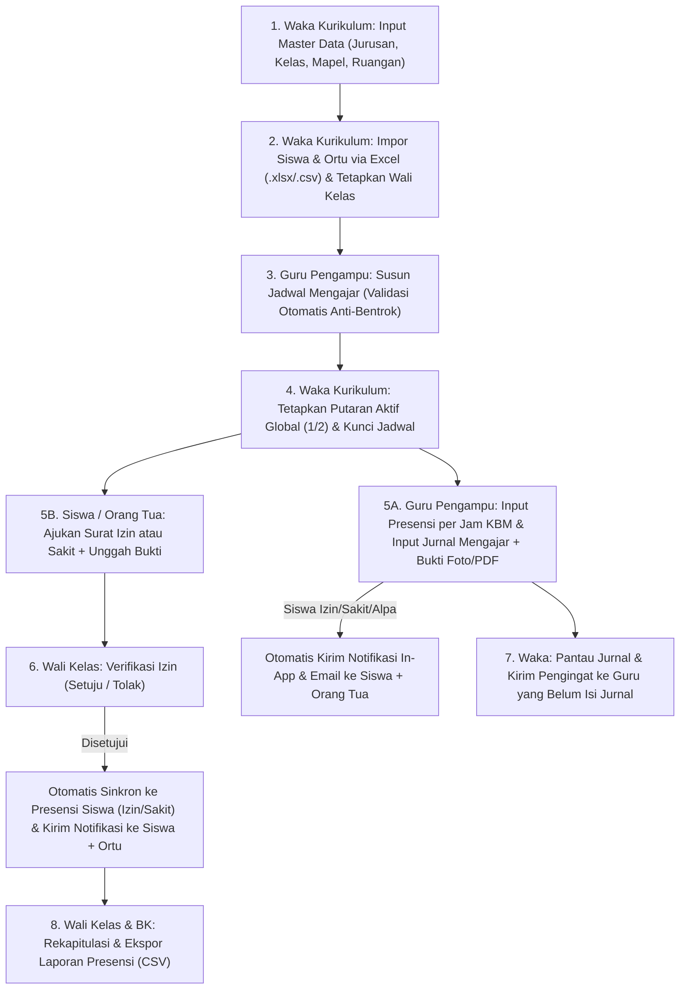

# Rekapitulasi Alur Kerja & Spesifikasi Sistem
## School Class Progress (SCP2 System)

Dokumen ini merangkum spesifikasi teknis, pembagian hak akses (*Role-Based Access Control*), struktur basis data, serta alur kerja (*workflow*) dari sistem **School Class Progress (SCP2)** secara menyeluruh.

---

## 1. Spesifikasi Teknis & Arsitektur Sistem

| Komponen | Spesifikasi |
| :--- | :--- |
| **Nama Aplikasi** | School Class Progress (SCP2 System) |
| **Framework Backend** | Laravel 12 (PHP 8.2 / 8.4) |
| **Database** | MySQL (`school2`) / SQLite (untuk *automated testing*) |
| **Frontend & UI** | Blade Template Engine, Bootstrap 5.3.3, Bootstrap Icons 1.11.3, Custom CSS Tema Waka (`#174ea6` & `#2563eb`), Vite |
| **Autentikasi** | Kredensial berbasis `login_key` (ID Login / NISN / ID Ortu) & `password` dengan *Rate Limiting* (Throttling) |
| **Penyimpanan Berkas** | Private Local Storage (`storage/app/private/journal_attachments` & `leave_attachments`) dengan validasi hak akses unduhan + proteksi *Base64 Upload Fallback* |
| **Layanan Email & Queue** | Laravel Mailable (`Envelope` & `Content`), Failover Mailer (`smtp` + `log`), mendukung pengiriman sinkron maupun asinkron (`ShouldQueue`) |
| **Impor & Ekspor Data** | Dukungan asli Microsoft Excel (`.xlsx` OpenXML) dan CSV (`.csv`) tanpa dependensi eksternal berat |
| **REST API** | JSON API (`/api/*`) dilengkapi koleksi Postman (`SCP2_API_Postman_Collection.json`) |
| **Pengujian Otomatis** | PHPUnit Feature & Unit Testing (87 skenario pengujian / >510 *assertions*) |

---

## 2. Daftar Peran Pengguna (6 Role Utama) & Kredensial Default

Sistem membagi pengguna ke dalam **6 peran (*role*)** dengan pembatasan middleware (`role:...`, `active`, `password.changed`):

| No | Role | Kode Role | Contoh Login ID (`login_key`) | Password Bawaan | Tugas & Kewenangan Utama |
| :-: | :--- | :--- | :--- | :--- | :--- |
| 1 | **Waka Kurikulum** | `waka` | `WAKA001` | `password123` | Mengelola Master Data (Jurusan, Kelas, Mapel, Ruangan), Impor Excel Siswa & Ortu, Kelola Akun, Penugasan Wali Kelas & Anak, Mengatur Putaran Blok Aktif Global (`Putaran 1` / `Putaran 2`), Mengunci Jadwal, Monitoring & Kirim Pengingat Jurnal Mengajar, serta Melihat Audit Log. *(Dibatasi maksimal 1 akun Waka aktif).* |
| 2 | **Guru Pengampu** | `guru` | `GURU_1` s.d. `GURU_5` | `password123` | Menyusun dan mengirim jadwal mengajar multi-baris ke Waka, mencatat presensi siswa per jam pelajaran pada putaran aktif, serta mengisi Jurnal Mengajar harian beserta unggah foto/dokumen bukti KBM. |
| 3 | **Wali Kelas** | `wali_kelas` | `WALI_10_RPL_1` s.d. `WALI_12_RPL_2` | `password123` | Memantau jadwal & presensi khusus kelas binaannya (1 Wali Kelas = 1 Kelas), memverifikasi (*Setuju / Tolak*) pengajuan surat izin/sakit siswa di kelasnya, serta melihat & mengekspor laporan rekap presensi kelasnya. |
| 4 | **Guru BK** | `bk` | `BK_1` s.d. `BK_6` | `password123` | Memantau riwayat kehadiran siswa lintas kelas secara keseluruhan dan mengunduh laporan rekapitulasi presensi (CSV) untuk tindak lanjut pembinaan/konseling. |
| 5 | **Siswa** | `siswa` | NISN 10 Digit (misal: `2026100001`) | `password123` | Melihat jadwal pelajaran kelasnya sesuai putaran aktif, memantau riwayat presensi pribadi di setiap mata pelajaran, serta mengajukan permohonan Izin/Sakit beserta lampiran surat bukti. |
| 6 | **Orang Tua / Wali** | `orang_tua` | `<nama_siswa>_ortu` (misal: `ahmad_fauzi_ortu`) | `password123` | Memantau jadwal pelajaran dan kehadiran harian anak yang terhubung dengan akunnya secara transparan, serta **mengajukan permohonan Izin/Sakit** untuk anaknya beserta lampiran bukti. |

---

## 3. Alur Kerja Sistem (End-to-End Workflow)

### Tahap 1: Persiapan Master Data & Impor Akun (Waka Kurikulum)
1. **Input Master Data (`/master-data`):**
   - Waka menambahkan data **Jurusan**, **Kelas/Rombel** (beserta fase `ganjil` untuk Putaran 1 atau `genap` untuk Putaran 2), **Mata Pelajaran**, dan **Ruangan/Lab**.
2. **Impor Massal Siswa & Orang Tua via Excel (`/master-data`):**
   - Waka mengunduh **Template Excel (`.xlsx`)** atau **Template CSV (`.csv`)**.
   - Waka mengisi kolom `student_login_id` (10 digit NISN), `student_name`, `class_name`, `major_code`, `parent_name`, serta opsional email pemulihan, lalu langsung mengunggah file `.xlsx` atau `.csv` tersebut **tanpa perlu mengisi/validasi password**.
   - Sistem secara otomatis:
     - Membuat akun **Siswa** dan menempatkannya ke kelas yang sesuai.
     - Membuat akun **Orang Tua** dengan Login ID otomatis `<nama_siswa>_ortu` dan menghubungkannya ke akun siswa tersebut.
     - Mengaktifkan seluruh akun dengan password bawaan `password123` tanpa paksaan ganti password saat login.
3. **Penugasan Wali Kelas (`/master-data`):**
   - Waka menetapkan Wali Kelas untuk setiap rombel (sistem menjamin 1 Wali Kelas hanya mengampu 1 kelas aktif).

---

### Tahap 2: Penyusunan Jadwal, Putaran Blok, & Penguncian (Guru & Waka)
1. **Input Jadwal Multi-Baris oleh Guru (`/schedules`):**
   - Guru menyusun jadwal mengajarnya menggunakan tombol **Tambah Baris** di bagian bawah form (dan dapat menghapus baris tambahan dengan tombol **Hapus Baris #N**).
   - **Validasi Anti-Bentrok Otomatis:** Sistem secara *real-time* (di form) maupun di server menolak jadwal apabila terjadi bentrok waktu pada **Hari & Putaran** yang sama untuk **Guru yang sama**, **Kelas yang sama**, atau **Ruangan yang sama**.
   - Saat jadwal berhasil dikirim, **Waka Kurikulum** otomatis menerima notifikasi pengajuan jadwal baru.
2. **Pengaturan Putaran Blok Global & Kunci Jadwal oleh Waka (`/schedules`):**
   - Waka dapat mengubah **Putaran Aktif Global** (`Putaran 1` atau `Putaran 2`). Seluruh halaman Jadwal, Presensi, dan Jurnal di akun semua pengguna otomatis menyesuaikan dengan putaran yang sedang aktif, dan seluruh guru menerima notifikasi perubahan putaran.
   - Waka dapat menekan tombol **Kunci Jadwal** agar jadwal yang sudah final tidak dapat diubah/ditambah lagi oleh guru.

---

### Tahap 3: Pelaksanaan KBM — Presensi & Jurnal Mengajar (Guru & Waka)
1. **Pencatatan Presensi per Mata Pelajaran (`/attendances`):**
   - Guru memilih jadwal mengajarnya pada putaran aktif, lalu mencatat status kehadiran setiap siswa di kelas tersebut (`Hadir`, `Izin`, `Sakit`, atau `Alpa`).
   - Jika ada siswa yang berstatus **selain `Hadir`** (`Izin`, `Sakit`, `Alpa`), sistem otomatis:
     - Mengirimkan **Notifikasi In-App** ke akun siswa.
     - Mengirimkan **Email Notifikasi Kehadiran (`StudentAttendanceNotification`)** ke alamat email pemulihan/akun Siswa dan Orang Tua.
2. **Pengisian Jurnal Mengajar & Unggah Bukti (`/journals`):**
   - Guru memilih jadwal mengajar, tanggal, materi pembelajaran, ringkasan kegiatan KBM, dan mengunggah **Foto / File PDF Bukti Mengajar** (mendukung pilih file maupun ambil foto langsung dari kamera perangkat).
   - Bukti mengajar disimpan di penyimpanan privat (`local` disk) dan hanya dapat diunduh oleh Guru pemilik jurnal tersebut atau Waka Kurikulum.
3. **Monitoring & Pengingat Jurnal oleh Waka (`/journals`):**
   - Waka dapat memfilter jurnal berdasarkan tanggal, melihat daftar jadwal guru yang **belum mengisi jurnal** pada tanggal tersebut, dan menekan tombol **Kirim Pengingat** untuk mengirimkan notifikasi pengingat satu kali per hari kepada masing-masing guru yang belum melengkapi jurnal.

---

### Tahap 4: Pengajuan & Verifikasi Perizinan (Siswa, Orang Tua, & Wali Kelas)
1. **Pengajuan Izin / Sakit oleh Siswa maupun Orang Tua (`/leaves/create`):**
   - Baik **Siswa** maupun **Orang Tua** dapat menekan tombol **Ajukan Izin Baru**.
   - Jika yang login adalah **Orang Tua**, tersedia pilihan **Pilih Anak / Siswa** yang terhubung dengan akunnya.
   - Pemohon memilih jenis (`Izin` atau `Sakit`), rentang tanggal (`Mulai` s.d. `Sampai`), alasan ketidakhadiran, serta mengunggah foto surat izin/surat dokter (PDF/JPG/PNG).
   - **Wali Kelas** dari kelas siswa tersebut otomatis menerima notifikasi permohonan izin baru.
2. **Persetujuan Wali Kelas & Sinkronisasi Otomatis ke Presensi (`/leaves`):**
   - Wali Kelas memeriksa berkas bukti izin dan menekan tombol **Setuju (`Approved`)** atau **Tolak (`Rejected`)**.
   - Apabila **Disetujui (`Approved`)**:
     - Sistem secara otomatis mengisi/memperbarui data **Presensi (`Attendance`)** siswa tersebut menjadi `Izin` atau `Sakit` beserta catatan alasannya pada **seluruh jadwal mata pelajaran** di kelas tersebut selama rentang tanggal izin berlangsung.
   - Sistem mengirimkan notifikasi pembaruan status izin sekaligus kepada **Siswa** dan **Orang Tua**.

---

### Tahap 5: Pelaporan, Keamanan Akun, & Audit Log
1. **Rekapitulasi & Ekspor Presensi (`/reports/attendance`):**
   - **Wali Kelas** (untuk kelas binaannya) dan **Guru BK** (untuk seluruh kelas) dapat memfilter statistik kehadiran berdasarkan tanggal dan kelas, melihat ringkasan `Hadir / Izin / Sakit / Alpa`, serta mengekspor laporan ke file **CSV/Excel**.
2. **Pengaturan Akun & Pemulihan Password via OTP (`/settings/account` & `/password/forgot`):**
   - Setiap pengguna dapat mengganti kata sandi dan mendaftarkan/memverifikasi **Email Pemulihan** menggunakan kode OTP 6 digit (`OtpVerifyRecoveryEmail`).
   - Pengguna yang lupa password dapat mereset password melalui pengiriman kode OTP 6 digit (`OtpResetPassword`) ke email pemulihan terverifikasi.
3. **Audit Log (`/audit-logs`):**
   - Seluruh aktivitas krusial (login, logout, buat/ubah akun, impor siswa, ubah master data, kunci jadwal, ubah putaran aktif, input presensi, input/edit jurnal, pengajuan & verifikasi izin) tercatat secara permanen dan dapat diaudit oleh **Waka Kurikulum**.

---

## 4. Struktur Tabel Basis Data Utama

1. `roles` — Menyimpan 6 role (`waka`, `bk`, `wali_kelas`, `guru`, `siswa`, `orang_tua`).
2. `users` — Menyimpan data akun pengguna, `login_key`, `role_id`, `class_id` (untuk siswa), `recovery_email`, `recovery_email_verified_at`, dan status `is_active`.
3. `parent_student` — Tabel pivot relasi *many-to-many* antara akun Orang Tua (`parent_id`) dan Siswa (`student_id`).
4. `majors` — Data jurusan (`code`, `name`).
5. `classes` — Data kelas/rombel (`name`, `major_id`, `homeroom_teacher_id`, `phase` [`ganjil`/`genap`]).
6. `subjects` — Data mata pelajaran (`code`, `name`).
7. `rooms` — Data ruangan/lab (`code`, `name`, `capacity`, `rules`).
8. `cycles` & `schedule_locks` — Menyimpan putaran blok global yang sedang aktif (`active_round`) dan status kunci jadwal (`is_locked`).
9. `schedules` — Data jadwal pelajaran (`teacher_id`, `class_id`, `subject_id`, `room_id`, `day`, `start_time`, `end_time`, `round`).
10. `attendances` — Data presensi siswa per jadwal dan tanggal (`schedule_id`, `student_id`, `date`, `status`, `notes`, `recorded_by`).
11. `teaching_journals` — Data jurnal mengajar guru (`schedule_id`, `teacher_id`, `date`, `materi`, `activity_summary`, `photo_proof`).
12. `leave_requests` — Data permohonan izin/sakit (`student_id`, `type`, `start_date`, `end_date`, `reason`, `attachment`, `status`, `processed_by`, `processed_at`).
13. `notifications` — Kotak masuk notifikasi in-app untuk pengguna.
14. `audit_logs` — Jejak rekam aktivitas seluruh pengguna di sistem.
15. `password_resets` & `recovery_email_verifications` — Penyimpanan token/hash OTP berbatas waktu (10 menit) dan batas percobaan (maksimal 5 kali).

